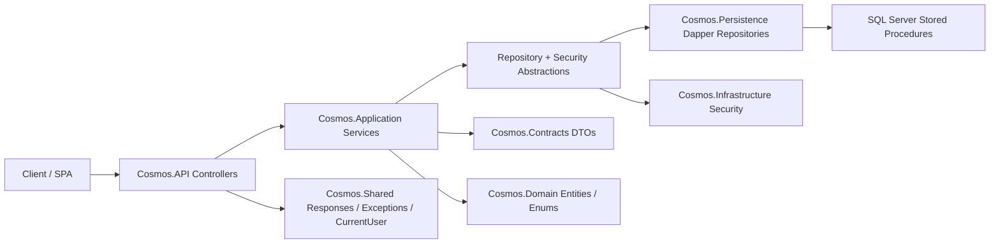
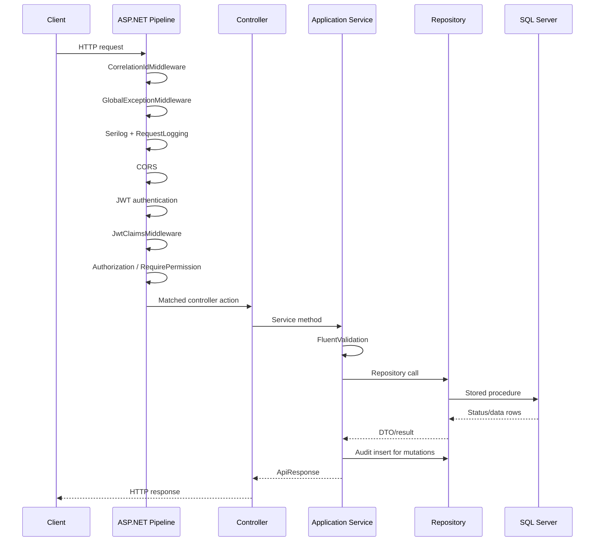
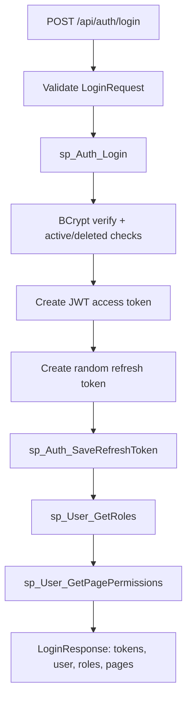
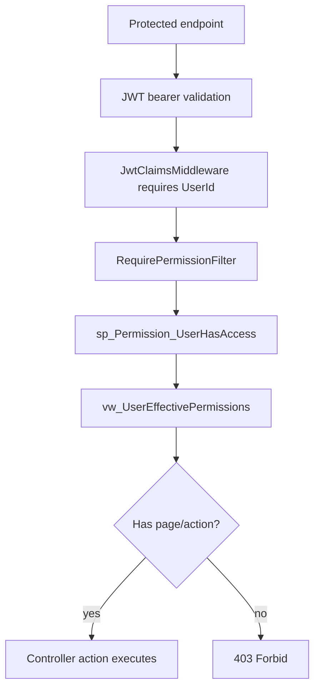
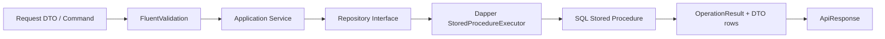
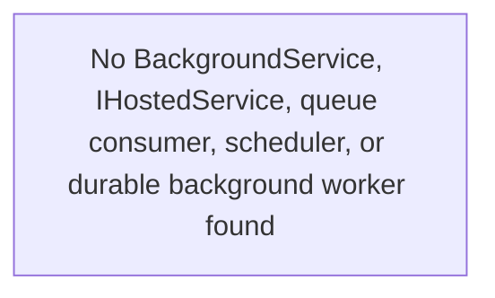

# Executive Summary

## What the Application Does
- Cosmos is a .NET 10 ASP.NET Core backend API for Cosmos ERP.
- It exposes JSON APIs for authentication, authorization, user/role/page/permission administration, party/customer-supplier style master data, item/catalog master data, units, categories, and HRMS operations.
- The API uses controller-based endpoints, JWT bearer authentication, custom SQL-backed permission checks, FluentValidation, Dapper, SQL Server stored procedures, and Serilog logging.

## Business Purpose
- The application is an ERP backend foundation. Its current modules cover security administration, ERP navigation/page permissions, party management, item master/catalog setup, inventory-related master data, and HRMS workflows.
- It appears intended to serve a frontend SPA running locally on `http://localhost:5173` / `https://localhost:5173` and later a production frontend host.

## Target Users
- ERP administrators managing users, roles, pages, and permissions.
- Back-office users managing parties, units, categories, and items.
- HR/payroll staff managing departments, designations, shifts, employees, attendance, leave, and payroll.
- Frontend clients that consume role/page permissions returned during login.

## Core Features
- JWT login, refresh-token rotation, logout, password change, forgot-password token generation, and password reset.
- Role-based page/action permissions stored in SQL Server and evaluated per request through `[RequirePermission]`.
- CRUD for users, roles, pages, parties, party settings, categories, units, and items.
- Multipart item image upload to `wwwroot/uploads/items`.
- HRMS: departments, designations, shifts, employees, employee documents, employee bank details, attendance, attendance adjustments, leave, payroll processing, payroll approval, payroll history, and payslip lookup.
- Audit log inserts from the service layer for most mutations.
- Request logging, correlation IDs, global exception handling, health check endpoint, Swagger/OpenAPI UI, Dockerfile-based container publishing.

# Architecture Overview

## Architecture Pattern Used
- Layered / Clean Architecture style with separate API, Application, Domain, Contracts, Persistence, Infrastructure, Shared, and Tests projects.
- The API project references all implementation projects and composes dependency injection.
- Application defines service interfaces, service implementations, validation, commands/queries, and persistence/security abstractions.
- Persistence implements repository abstractions using Dapper and SQL Server stored procedures.
- Infrastructure implements JWT and BCrypt services.
- Domain contains entity classes and enums.
- Contracts contains public DTOs and request/response records.

## Layer Structure
- `Cosmos.API`: ASP.NET Core host, middleware, controllers, custom authorization filter, Swagger, CORS, health check.
- `Cosmos.Application`: use-case services, validators, commands, queries, and abstractions.
- `Cosmos.Domain`: entity models and domain enums.
- `Cosmos.Contracts`: API DTOs, request models, operation/paged result contracts.
- `Cosmos.Persistence`: SQL Server connection factory, Dapper helpers, repositories, stored procedure calls.
- `Cosmos.Infrastructure`: JWT bearer setup, token creation, BCrypt password hashing.
- `Cosmos.Shared`: cross-cutting response, exception, JWT option, and current-user types.
- `Cosmos.Tests`: xUnit tests for password validation, BCrypt, and JWT claims.

## Dependency Flow
- API -> Application, Contracts, Domain, Infrastructure, Persistence, Shared.
- Application -> Domain, Contracts, Shared, FluentValidation abstractions.
- Persistence -> Application abstractions, Domain/Contracts, Shared, Dapper, Microsoft.Data.SqlClient.
- Infrastructure -> Application security abstractions, Contracts/Shared, JWT/BCrypt packages.
- Domain and Contracts are dependency-light.

## Design Patterns Identified
- Dependency Injection through extension methods: `AddApplication`, `AddPersistence`, `AddInfrastructure`.
- Repository pattern for persistence abstraction.
- Service layer / use-case orchestration.
- DTO/contract records separated from persistence/domain classes.
- Command/query record naming for item, party, and HR modules.
- FluentValidation validators per request/command/query.
- Custom MVC authorization filter through `TypeFilterAttribute`.
- Middleware pipeline for correlation ID, exception handling, request logging, JWT claim guard, and audit logging.
- Stored procedure based data access with Dapper.
- Consistent `ApiResponse<T>` / `ApiResponse` envelope.

# Project Structure Analysis

## Repository Root
- `Cosmos.slnx`: solution file listing all source and test projects.
- `Directory.Build.props`: enables XML documentation file generation, disables warnings-as-errors, suppresses missing XML comment warning `1591`.
- `Dockerfile`: multi-stage .NET 10 SDK/runtime image build for `Cosmos.API`, listening on port `8080`.
- `.dockerignore`, `.gitignore`: basic ignore files.
- `.vs/`, `artifacts/`: local/generated folders, not part of core source.

## `src/Cosmos.API`
- Purpose: ASP.NET Core web API host.
- Responsibilities:
  - Configures Serilog, CORS, controllers, Swagger, health checks, authentication, authorization, middleware, static files, and endpoints.
  - Hosts all HTTP controllers.
  - Defines custom permission filter attributes.
- Important files:
  - `Program.cs`: application composition and request pipeline.
  - `appsettings.json`: connection string, JWT settings, Serilog level, CORS origins.
  - `appsettings.Development.json`: development Serilog override.
  - `Properties/launchSettings.json`: local HTTP/HTTPS launch profiles.
  - `Cosmos.API.http`: HTTP scratch file.
- Relationships:
  - Calls `AddApplication`, `AddPersistence`, and `AddInfrastructure`.
  - Controllers call application service interfaces.
  - Middleware and filters depend on shared response/exception and permission service abstractions.

### `src/Cosmos.API/Controllers`
- Purpose: HTTP API boundary for non-HR modules.
- Important files:
  - `ApiControllerBase.cs`: common response conversion and `CurrentUserId`.
  - `AuthController.cs`: anonymous/authenticated auth endpoints.
  - `UsersController.cs`, `RolesController.cs`, `PermissionsController.cs`, `PagesController.cs`: security administration.
  - `PartiesController.cs`, `PartySettingsController.cs`: party management.
  - `CategoriesController.cs`, `ItemsController.cs`, `UnitsController.cs`: item catalog management.
- Relationships:
  - Every non-auth controller is `[Authorize]`.
  - Most actions use `[RequirePermission(page, action)]`.
  - Responses are wrapped with `ApiResponse`.

### `src/Cosmos.API/Controllers/HR`
- Purpose: HRMS HTTP API boundary.
- Important files:
  - `DepartmentsController.cs`, `DesignationsController.cs`, `ShiftsController.cs`.
  - `EmployeesController.cs`.
  - `AttendanceController.cs`.
  - `LeavesController.cs`.
  - `PayrollController.cs`.
- Relationships:
  - All controllers use `IHrService`.
  - All actions require JWT plus HR page/action permissions from `HrPermissions`.

### `src/Cosmos.API/Middleware`
- Purpose: request/response cross-cutting behavior.
- Important files:
  - `CorrelationIdMiddleware.cs`: reads/generates `X-Correlation-Id`, adds response header, logger scope.
  - `GlobalExceptionMiddleware.cs`: converts `CosmosException` and unknown exceptions to `ApiResponse.Failure`.
  - `JwtClaimsMiddleware.cs`: rejects authenticated tokens without a `UserId` claim.
  - `RequestLoggingMiddleware.cs`: logs method/path/status/duration.
  - `AuditMiddleware.cs`: logs mutating HTTP requests after completion; database auditing happens mainly in services.

### `src/Cosmos.API/Security`
- Purpose: permission authorization attribute/filter.
- Important files:
  - `RequirePermissionAttribute.cs`: MVC type filter wrapper.
  - `RequirePermissionFilter.cs`: extracts `UserId` claim and calls `IPermissionService.UserHasPermissionAsync`.

## `src/Cosmos.Application`
- Purpose: business/use-case layer.
- Responsibilities:
  - Defines service interfaces and implementations.
  - Validates inputs with FluentValidation.
  - Coordinates persistence and audit logging.
  - Defines commands and queries for modules that are not plain contract DTOs.
- Important files:
  - `DependencyInjection.cs`: service and validator registration.
  - `Services/*.cs`: use-case services.
  - `Validators/*.cs`: FluentValidation rules.
  - `Abstractions/Services/*.cs`: service contracts consumed by controllers.
  - `Abstractions/Persistence/*.cs`: repository contracts implemented by Persistence.
  - `Abstractions/Security/*.cs`: `ITokenService`, `IPasswordHasher`.
  - `Items/Commands`, `Items/Queries`, `Parties/Commands`, `Parties/Queries`, `HR/HrRequests.cs`: request models.
- Relationships:
  - Does not directly reference Persistence or Infrastructure.
  - Depends on repository/security abstractions and shared exceptions/responses.

## `src/Cosmos.Contracts`
- Purpose: external API DTO and shared contract records.
- Responsibilities:
  - Defines DTOs returned by controllers/services.
  - Defines request contracts for auth, users, roles, permissions, pages.
  - Defines common `OperationResult` and `PagedResult<T>`.
- Important folders:
  - `Auth`, `Users`, `Roles`, `Permissions`, `Pages`.
  - `Parties`, `Items`, `HR`, `Audit`, `Common`.
- Relationships:
  - Used by API, Application, Persistence, Infrastructure tests.

## `src/Cosmos.Domain`
- Purpose: domain model and enums.
- Responsibilities:
  - Provides entity classes matching database concepts.
  - Provides enum definitions for permission actions, party GST/opening-balance values, item type, and HR statuses.
- Important folders:
  - `Entities`: security, party, item, category, unit, audit, refresh token entities.
  - `HR`: HR entities/enums.
  - `Items`, `Parties`, `Security`: module enums/constants.
- Relationships:
  - Used by Application and Persistence.
  - Entities are not exposed directly as primary API contracts except internally.

## `src/Cosmos.Persistence`
- Purpose: SQL Server data access.
- Responsibilities:
  - Opens SQL connections using `ConnectionStrings:CosmosDb`.
  - Executes stored procedures through Dapper.
  - Implements repository interfaces.
  - Builds table-valued parameters for role/permission updates.
- Important files:
  - `DependencyInjection.cs`: repository registration.
  - `Connection/SqlConnectionFactory.cs`: opens `SqlConnection`.
  - `Dapper/StoredProcedureExecutor.cs`: common query/status execution helpers.
  - `Dapper/TableValuedParameters.cs`: `IntIdList` and `PermissionList`.
  - `UnitOfWork/UnitOfWork.cs`: transaction wrapper, currently not integrated with repository operations.
  - `Repositories/*.cs`: repository implementations.
- Relationships:
  - Depends on Application abstractions.
  - Calls stored procedures defined in `database/*.sql`.

## `src/Cosmos.Infrastructure`
- Purpose: technical security infrastructure.
- Responsibilities:
  - Registers JWT bearer authentication.
  - Creates JWT access tokens and random refresh tokens.
  - Hashes/verifies passwords with BCrypt.
- Important files:
  - `DependencyInjection.cs`: JWT bearer setup and token extraction.
  - `Security/JwtTokenService.cs`: access/refresh token creation.
  - `Security/BcryptPasswordHasher.cs`: BCrypt work factor 12.

## `src/Cosmos.Shared`
- Purpose: cross-layer support types.
- Important files:
  - `Responses/ApiResponse.cs`: API response envelopes.
  - `Exceptions/CosmosException.cs`: exception hierarchy carrying HTTP status.
  - `Options/JwtOptions.cs`: bound JWT config.
  - `Security/CurrentUser.cs`: current claims principal projection.

## `tests/Cosmos.Tests`
- Purpose: unit tests.
- Important files:
  - `Validation/CreateUserRequestValidatorTests.cs`.
  - `Security/BcryptPasswordHasherTests.cs`.
  - `Security/JwtTokenServiceTests.cs`.
- Current coverage:
  - Password policy acceptance/rejection.
  - BCrypt hash/verify.
  - JWT includes only user identity claims and excludes role/page/permission claims.

## `database`
- Purpose: idempotent SQL Server deployment scripts.
- Important files:
  - `CosmosERP.Security.sql`: users, roles, pages, permissions, refresh/reset tokens, audit logs, security stored procedures, admin seed data.
  - `001_Party_Module.sql`: party tables/settings/procedures and party page permission seed.
  - `Scripts/002_ItemModule.sql`: units/categories/items schema and procedures.
  - `Scripts/HR/001_HRMS_Module.sql`: HRMS schema, procedures, seeds, HR permission pages.

# Database Analysis

## Database Technology
- SQL Server, targeted by scripts for SQL Server 2022.
- Data access uses Dapper and `Microsoft.Data.SqlClient`.
- There is no Entity Framework Core usage and no EF migration folder.
- Schema changes are represented as idempotent `.sql` scripts.

## Core Tables and Relationships
- Security:
  - `Users`: unique `Username`, unique `Email`, BCrypt `PasswordHash`, active/deleted flags.
  - `Roles`: unique role names.
  - `UserRoles`: many-to-many join between users and roles.
  - `Pages`: ERP navigation/permission pages, self-referencing parent page.
  - `RolePermissions`: role/page permissions with `CanView`, `CanCreate`, `CanEdit`, `CanDelete`, `CanExport`, `CanApprove`.
  - `RefreshTokens`: refresh tokens per user.
  - `PasswordResetTokens`: reset tokens per user.
  - `AuditLogs`: table name, record ID, action type, old/new JSON, created user.
  - `vw_UserEffectivePermissions`: aggregates permissions across active roles.
- Party:
  - `Parties`: party master data, GST fields, billing/shipping fields, credit fields, soft delete, rowversion.
  - `PartySettings`: singleton-ish settings row for party behavior/print/additional fields.
- Item/catalog:
  - `Units`: unit master.
  - `Categories`: category master.
  - `Items`: item master, FK to categories and units.
- HRMS:
  - `HR_Departments`.
  - `HR_Designations` -> `HR_Departments`.
  - `HR_Shifts`.
  - `HR_Employees` -> departments, designations, reporting manager, shift.
  - `HR_EmployeeAddresses`, `HR_EmployeeBankAccounts`, `HR_EmployeeDocuments` -> employees.
  - `HR_Attendance` -> employees.
  - `HR_AttendanceAdjustments` -> employees and attendance.
  - `HR_LeaveTypes`, `HR_LeaveBalances`, `HR_LeaveApplications`.
  - `HR_SalaryStructures`, `HR_SalaryComponents`, `HR_SalaryStructureComponents`, `HR_EmployeeSalaryStructures`.
  - `HR_PayrollRuns`, `HR_PayrollDetails`.

## Migrations
- No EF migrations exist.
- Scripts are intended to be run manually or by deployment automation. The current repository does not include an automated migrator, DbUp/Flyway/Liquibase setup, or startup migration runner.

## Data Flow
1. Controller receives HTTP request.
2. Application service validates request with FluentValidation.
3. Service calls repository abstraction.
4. Repository opens SQL connection through `SqlConnectionFactory`.
5. Repository executes stored procedure through Dapper.
6. Stored procedure returns rows directly or a first `OperationResult` status row followed by data.
7. `StoredProcedureExecutor` maps data/status and may throw `CosmosException` for status failures in `QueryWithStatusAsync`.
8. Service wraps result in `ApiResponse<T>` and writes audit entries for mutations.

## Repository Patterns
- Each module has an interface in `Cosmos.Application.Abstractions.Persistence` and implementation in `Cosmos.Persistence.Repositories`.
- Read operations commonly call `QueryAsync<T>` or `QuerySingleOrDefaultAsync<T>`.
- Create/update operations commonly call `QueryWithStatusAsync<T>` expecting `OperationResult` plus a row.
- Delete/status operations call `ExecuteStatusAsync`.
- Role/user assignment uses SQL table-valued parameters:
  - `dbo.IntIdList`.
  - `dbo.PermissionList`.

# API Documentation

All responses are JSON. Successful responses use `ApiResponse<T>` or `ApiResponse`; unhandled exceptions are converted by `GlobalExceptionMiddleware`. Most service/repository status failures are thrown as `CosmosException` and preserve the status code. `ApiControllerBase.FromResponse` returns HTTP 400 for a non-exception failure response.

## Auth Endpoints

| Method | Route | Request Model | Response Model | Purpose | Dependencies |
|---|---|---|---|---|---|
| POST | `/api/auth/login` | `LoginRequest` | `ApiResponse<LoginResponse>` | Validate username/email and password, create JWT/refresh token, return user roles and page permissions. | `IAuthService`, `IAuthRepository`, `IUserRepository`, `ITokenService`, `IPasswordHasher`, `sp_Auth_Login`, `sp_Auth_SaveRefreshToken`, `sp_User_GetRoles`, `sp_User_GetPagePermissions` |
| POST | `/api/auth/refresh-token` | `RefreshTokenRequest` | `ApiResponse<LoginResponse>` | Validate and rotate refresh token. | `IAuthService`, `sp_Auth_RefreshToken`, `sp_Auth_Logout`, token service |
| POST | `/api/auth/logout` | `LogoutRequest` | `ApiResponse` | Revoke supplied refresh token. | JWT auth, `IAuthService`, `sp_Auth_Logout` |
| POST | `/api/auth/change-password` | `ChangePasswordRequest` | `ApiResponse` | Verify current password and store new BCrypt hash. | JWT auth, `IAuthService`, `sp_User_GetEntityById`, `sp_Auth_ChangePassword` |
| POST | `/api/auth/forgot-password` | `ForgotPasswordRequest` | `ApiResponse` | Generate password reset token for an active email. | `IAuthService`, `sp_Auth_ForgotPassword` |
| POST | `/api/auth/reset-password` | `ResetPasswordRequest` | `ApiResponse` | Validate reset token and update password. | `IAuthService`, `sp_Auth_ResetPassword` |

## Security Administration Endpoints

| Method | Route | Request Model | Response Model | Purpose | Dependencies |
|---|---|---|---|---|---|
| GET | `/api/users` | none | `ApiResponse<IReadOnlyCollection<UserDto>>` | List non-deleted users. | JWT, `Users/View`, `IUserService`, `sp_User_GetAll` |
| GET | `/api/users/{id}` | route `int id` | `ApiResponse<UserDto>` | Get user by ID. | JWT, `Users/View`, `sp_User_GetById` |
| POST | `/api/users` | `CreateUserRequest` | `ApiResponse<UserDto>` | Create user with BCrypt password hash. | JWT, `Users/Create`, validators, `sp_User_Create`, audit |
| PUT | `/api/users/{id}` | `UpdateUserRequest` | `ApiResponse<UserDto>` | Update email/full name/active flag. | JWT, `Users/Edit`, `sp_User_Update`, audit |
| DELETE | `/api/users/{id}` | route `int id` | `ApiResponse` | Soft delete user and revoke tokens. | JWT, `Users/Delete`, `sp_User_Delete`, audit |
| PATCH | `/api/users/{id}/activate` | route `int id` | `ApiResponse` | Activate user. | JWT, `Users/Edit`, `sp_User_SetActive`, audit |
| PATCH | `/api/users/{id}/deactivate` | route `int id` | `ApiResponse` | Deactivate user and revoke tokens. | JWT, `Users/Edit`, `sp_User_SetActive`, audit |
| POST | `/api/users/{id}/roles` | `AssignUserRolesRequest` | `ApiResponse` | Replace user role assignments. | JWT, `Users/Edit`, TVP `IntIdList`, `sp_User_AssignRoles`, audit |
| GET | `/api/roles` | none | `ApiResponse<IReadOnlyCollection<RoleDetailDto>>` | List roles. | JWT, `Roles/View`, `sp_Role_GetAll` |
| GET | `/api/roles/{id}` | route `int id` | `ApiResponse<RoleDetailDto>` | Get role by ID. | JWT, `Roles/View`, `sp_Role_GetById` |
| POST | `/api/roles` | `CreateRoleRequest` | `ApiResponse<RoleDetailDto>` | Create role. | JWT, `Roles/Create`, `sp_Role_Create`, audit |
| PUT | `/api/roles/{id}` | `UpdateRoleRequest` | `ApiResponse<RoleDetailDto>` | Update role. | JWT, `Roles/Edit`, `sp_Role_Update`, audit |
| DELETE | `/api/roles/{id}` | route `int id` | `ApiResponse` | Delete role and dependent assignments/permissions. | JWT, `Roles/Delete`, `sp_Role_Delete`, audit |
| GET | `/api/permissions/role/{roleId}` | route `int roleId` | `ApiResponse<IReadOnlyCollection<PermissionDto>>` | Get permissions for a role. | JWT, `Permissions/View`, `sp_Permission_GetByRoleId` |
| PUT | `/api/permissions/role/{roleId}` | `SaveRolePermissionsRequest` | `ApiResponse` | Replace role permissions. | JWT, `Permissions/Edit`, TVP `PermissionList`, `sp_Permission_Save`, audit |
| GET | `/api/pages` | none | `ApiResponse<IReadOnlyCollection<PageDto>>` | List ERP pages. | JWT, `Pages/View`, `sp_Page_GetAll` |
| GET | `/api/pages/{id}` | route `int id` | `ApiResponse<PageDto>` | Get page. | JWT, `Pages/View`, `sp_Page_GetById` |
| POST | `/api/pages` | `CreatePageRequest` | `ApiResponse<PageDto>` | Create page. | JWT, `Pages/Create`, `sp_Page_Create`, audit |
| PUT | `/api/pages/{id}` | `UpdatePageRequest` | `ApiResponse<PageDto>` | Update page display/routing metadata. | JWT, `Pages/Edit`, `sp_Page_Update`, audit |
| DELETE | `/api/pages/{id}` | route `int id` | `ApiResponse` | Delete page and role permissions. | JWT, `Pages/Delete`, `sp_Page_Delete`, audit |

## Party Endpoints

| Method | Route | Request Model | Response Model | Purpose | Dependencies |
|---|---|---|---|---|---|
| GET | `/api/v1/parties` | query `GetPartiesQuery` | `ApiResponse<PagedResult<PartyListItemDto>>` | Paginated party list. | JWT, `Party/View`, `sp_Party_GetList` |
| GET | `/api/v1/parties/{id}` | route `Guid id` | `ApiResponse<PartyDto>` | Get party by ID. | JWT, `Party/View`, `sp_Party_GetById` |
| POST | `/api/v1/parties` | `CreatePartyCommand` | `ApiResponse<PartyDto>` | Create party. | JWT, `Party/Create`, validators, `sp_Party_Create`, audit |
| PUT | `/api/v1/parties/{id}` | `UpdatePartyCommand` | `ApiResponse<PartyDto>` | Update party. | JWT, `Party/Edit`, `sp_Party_Update`, audit |
| DELETE | `/api/v1/parties/{id}` | route `Guid id` | `ApiResponse` | Soft delete party. | JWT, `Party/Delete`, `sp_Party_Delete`, audit |
| PATCH | `/api/v1/parties/{id}/status` | `ChangePartyStatusCommand` | `ApiResponse` | Activate/deactivate party. | JWT, `Party/Edit`, `sp_Party_SetActive`, audit |
| GET | `/api/v1/settings/party` | none | `ApiResponse<PartySettingsDto>` | Get party settings. | JWT, `Party/View`, `sp_PartySettings_Get` |
| PUT | `/api/v1/settings/party` | `UpdatePartySettingsCommand` | `ApiResponse<PartySettingsDto>` | Update party settings. | JWT, `Party/Edit`, `sp_PartySettings_Update`, audit |

## Item/Catalog Endpoints

| Method | Route | Request Model | Response Model | Purpose | Dependencies |
|---|---|---|---|---|---|
| GET | `/api/categories` | query `GetCategoriesQuery` | `ApiResponse<PagedResult<CategoryListItemDto>>` | Paginated category list. | JWT, `Categories/View`, `sp_Category_GetList` |
| GET | `/api/categories/{id}` | route `long id` | `ApiResponse<CategoryDto>` | Get category. | JWT, `Categories/View`, `sp_Category_GetById` |
| POST | `/api/categories` | `CreateCategoryCommand` | `ApiResponse<CategoryDto>` | Create category. | JWT, `Categories/Create`, validators, `sp_Category_Create`, audit |
| PUT | `/api/categories/{id}` | `UpdateCategoryCommand` | `ApiResponse<CategoryDto>` | Update category. | JWT, `Categories/Edit`, `sp_Category_Update`, audit |
| DELETE | `/api/categories/{id}` | route `long id` | `ApiResponse` | Soft delete category. | JWT, `Categories/Delete`, `sp_Category_Delete`, audit |
| GET | `/api/units` | query `GetUnitsQuery` | `ApiResponse<PagedResult<UnitListItemDto>>` | Paginated unit list. | JWT, `Units/View`, `sp_Unit_GetList` |
| GET | `/api/units/{id}` | route `long id` | `ApiResponse<UnitDto>` | Get unit. | JWT, `Units/View`, `sp_Unit_GetById` |
| POST | `/api/units` | `CreateUnitCommand` | `ApiResponse<UnitDto>` | Create unit. | JWT, `Units/Create`, validators, `sp_Unit_Create`, audit |
| PUT | `/api/units/{id}` | `UpdateUnitCommand` | `ApiResponse<UnitDto>` | Update unit. | JWT, `Units/Edit`, `sp_Unit_Update`, audit |
| DELETE | `/api/units/{id}` | route `long id` | `ApiResponse` | Soft delete unit. | JWT, `Units/Delete`, `sp_Unit_Delete`, audit |
| GET | `/api/items` | query `GetItemsQuery` | `ApiResponse<PagedResult<ItemListItemDto>>` | Paginated item list. | JWT, `Items/View`, `sp_Item_GetList` |
| GET | `/api/items/{id}` | route `long id` | `ApiResponse<ItemDto>` | Get item. | JWT, `Items/View`, `sp_Item_GetById` |
| POST | `/api/items` | multipart form `CreateItemFormRequest` | `ApiResponse<ItemDto>` | Upload optional image and create item. | JWT, `Items/Create`, `IWebHostEnvironment`, image file system, `sp_Item_Create`, audit |
| PUT | `/api/items/{id}` | `UpdateItemCommand` | `ApiResponse<ItemDto>` | Update item. | JWT, `Items/Edit`, validators, `sp_Item_Update`, audit |
| DELETE | `/api/items/{id}` | route `long id` | `ApiResponse` | Soft delete item. | JWT, `Items/Delete`, `sp_Item_Delete`, audit |

## HRMS Endpoints

| Method | Route | Request Model | Response Model | Purpose | Dependencies |
|---|---|---|---|---|---|
| GET | `/api/hr/departments` | query `HrPagedQuery` | `ApiResponse<PagedResult<DepartmentDto>>` | List departments. | JWT, `HR.Department/View`, `IHrService`, `sp_HR_Department_GetList` |
| GET | `/api/hr/departments/{id}` | route `long id` | `ApiResponse<DepartmentDto>` | Get department. | JWT, `HR.Department/View`, `sp_HR_Department_GetById` |
| POST | `/api/hr/departments` | `CreateDepartmentCommand` | `ApiResponse<DepartmentDto>` | Create department. | JWT, `HR.Department/Create`, validators, audit |
| PUT | `/api/hr/departments/{id}` | `UpdateDepartmentCommand` | `ApiResponse<DepartmentDto>` | Update department. | JWT, `HR.Department/Edit`, audit |
| DELETE | `/api/hr/departments/{id}` | route `long id` | `ApiResponse` | Soft delete department. | JWT, `HR.Department/Delete`, audit |
| GET | `/api/hr/designations` | query `HrPagedQuery` | `ApiResponse<PagedResult<DesignationDto>>` | List designations. | JWT, `HR.Designation/View` |
| GET | `/api/hr/designations/{id}` | route `long id` | `ApiResponse<DesignationDto>` | Get designation. | JWT, `HR.Designation/View` |
| POST | `/api/hr/designations` | `CreateDesignationCommand` | `ApiResponse<DesignationDto>` | Create designation. | JWT, `HR.Designation/Create` |
| PUT | `/api/hr/designations/{id}` | `UpdateDesignationCommand` | `ApiResponse<DesignationDto>` | Update designation. | JWT, `HR.Designation/Edit` |
| DELETE | `/api/hr/designations/{id}` | route `long id` | `ApiResponse` | Soft delete designation. | JWT, `HR.Designation/Delete` |
| GET | `/api/hr/shifts` | query `HrPagedQuery` | `ApiResponse<PagedResult<ShiftDto>>` | List shifts. | JWT, `HR.Shift/View` |
| GET | `/api/hr/shifts/{id}` | route `long id` | `ApiResponse<ShiftDto>` | Get shift. | JWT, `HR.Shift/View` |
| POST | `/api/hr/shifts` | `CreateShiftCommand` | `ApiResponse<ShiftDto>` | Create shift. | JWT, `HR.Shift/Create` |
| PUT | `/api/hr/shifts/{id}` | `UpdateShiftCommand` | `ApiResponse<ShiftDto>` | Update shift. | JWT, `HR.Shift/Edit` |
| DELETE | `/api/hr/shifts/{id}` | route `long id` | `ApiResponse` | Soft delete shift. | JWT, `HR.Shift/Delete` |
| GET | `/api/hr/employees` | query `GetEmployeesQuery` | `ApiResponse<PagedResult<EmployeeListItemDto>>` | List employees. | JWT, `HR.Employee/View` |
| GET | `/api/hr/employees/dropdown` | query `search` | `ApiResponse<IReadOnlyCollection<EmployeeDropdownDto>>` | Employee dropdown lookup. | JWT, `HR.Employee/View` |
| GET | `/api/hr/employees/reporting-managers` | query `departmentId`, `excludingEmployeeId` | `ApiResponse<IReadOnlyCollection<EmployeeDropdownDto>>` | Reporting manager lookup. | JWT, `HR.Employee/View` |
| GET | `/api/hr/employees/{id}` | route `long id` | `ApiResponse<EmployeeDto>` | Get employee. | JWT, `HR.Employee/View` |
| POST | `/api/hr/employees` | `CreateEmployeeCommand` | `ApiResponse<EmployeeDto>` | Create employee with optional addresses and bank details. | JWT, `HR.Employee/Create` |
| PUT | `/api/hr/employees/{id}` | `UpdateEmployeeCommand` | `ApiResponse<EmployeeDto>` | Update employee. | JWT, `HR.Employee/Edit` |
| DELETE | `/api/hr/employees/{id}` | route `long id` | `ApiResponse` | Soft delete employee. | JWT, `HR.Employee/Delete` |
| GET | `/api/hr/employees/{id}/documents` | route `long id` | `ApiResponse<IReadOnlyCollection<EmployeeDocumentDto>>` | List employee documents. | JWT, `HR.Employee/View` |
| POST | `/api/hr/employees/{id}/documents` | `AddEmployeeDocumentCommand` | `ApiResponse<EmployeeDocumentDto>` | Add employee document metadata. | JWT, `HR.Employee/Edit` |
| DELETE | `/api/hr/employees/documents/{id}` | route `long id` | `ApiResponse` | Soft delete employee document. | JWT, `HR.Employee/Edit` |
| GET | `/api/hr/employees/{id}/bank-details` | route `long id` | `ApiResponse<IReadOnlyCollection<EmployeeBankAccountDto>>` | List bank details. | JWT, `HR.Employee/View` |
| POST | `/api/hr/employees/{id}/bank-details` | `AddEmployeeBankDetailsCommand` | `ApiResponse<EmployeeBankAccountDto>` | Add bank details. | JWT, `HR.Employee/Edit` |
| POST | `/api/hr/attendance/check-in` | `AttendanceCheckInCommand` | `ApiResponse<AttendanceDto>` | Check employee in. | JWT, `HR.Attendance/Edit` |
| POST | `/api/hr/attendance/check-out` | `AttendanceCheckOutCommand` | `ApiResponse<AttendanceDto>` | Check employee out. | JWT, `HR.Attendance/Edit` |
| POST | `/api/hr/attendance/manual-entry` | `AttendanceManualEntryCommand` | `ApiResponse<AttendanceDto>` | Create manual attendance. | JWT, `HR.Attendance/Edit` |
| GET | `/api/hr/attendance` | query `GetAttendanceQuery` | `ApiResponse<PagedResult<AttendanceDto>>` | List attendance. | JWT, `HR.Attendance/View` |
| GET | `/api/hr/attendance/{employeeId}` | route `employeeId`, query `fromDate`, `toDate` | `ApiResponse<IReadOnlyCollection<AttendanceDto>>` | Employee attendance history. | JWT, `HR.Attendance/View` |
| POST | `/api/hr/attendance/adjustment-request` | `AttendanceAdjustmentRequestCommand` | `ApiResponse<AttendanceAdjustmentDto>` | Request attendance adjustment. | JWT, `HR.Attendance/Edit` |
| POST | `/api/hr/attendance/approve-adjustment` | `AttendanceAdjustmentDecisionCommand` | `ApiResponse<AttendanceAdjustmentDto>` | Approve attendance adjustment. | JWT, `HR.Attendance/Approve` |
| POST | `/api/hr/attendance/reject-adjustment` | `AttendanceAdjustmentDecisionCommand` | `ApiResponse<AttendanceAdjustmentDto>` | Reject attendance adjustment. | JWT, `HR.Attendance/Approve` |
| GET | `/api/hr/attendance/monthly-report` | query `AttendanceMonthlyReportQuery` | `ApiResponse<IReadOnlyCollection<AttendanceMonthlyReportDto>>` | Monthly attendance report. | JWT, `HR.Attendance/View` |
| GET | `/api/hr/attendance/department-report` | query `AttendanceDepartmentReportQuery` | `ApiResponse<IReadOnlyCollection<AttendanceDepartmentReportDto>>` | Department daily attendance report. | JWT, `HR.Attendance/View` |
| POST | `/api/hr/leaves/apply` | `ApplyLeaveCommand` | `ApiResponse<LeaveApplicationDto>` | Apply for leave. | JWT, `HR.Leave/Create` |
| POST | `/api/hr/leaves/cancel` | `LeaveActionCommand` | `ApiResponse<LeaveApplicationDto>` | Cancel leave. | JWT, `HR.Leave/Create` |
| POST | `/api/hr/leaves/approve` | `LeaveActionCommand` | `ApiResponse<LeaveApplicationDto>` | Approve leave. | JWT, `HR.Leave/Approve` |
| POST | `/api/hr/leaves/reject` | `LeaveActionCommand` | `ApiResponse<LeaveApplicationDto>` | Reject leave. | JWT, `HR.Leave/Approve` |
| GET | `/api/hr/leaves` | query `GetLeavesQuery` | `ApiResponse<PagedResult<LeaveApplicationDto>>` | List leave applications. | JWT, `HR.Leave/View` |
| GET | `/api/hr/leaves/balance` | query `employeeId` | `ApiResponse<IReadOnlyCollection<LeaveBalanceDto>>` | Get leave balances. | JWT, `HR.Leave/View` |
| GET | `/api/hr/leaves/pending-approvals` | query `GetPendingLeaveApprovalsQuery` | `ApiResponse<PagedResult<LeaveApplicationDto>>` | Pending leave approvals. | JWT, `HR.Leave/Approve` |
| POST | `/api/hr/payroll/process` | `ProcessPayrollCommand` | `ApiResponse<PayrollRunDto>` | Process payroll for month/year. | JWT, `HR.Payroll/Create` |
| POST | `/api/hr/payroll/approve` | `ApprovePayrollCommand` | `ApiResponse<PayrollRunDto>` | Approve processed payroll. | JWT, `HR.Payroll/Approve` |
| GET | `/api/hr/payroll/run/{id}` | route `long id` | `ApiResponse<PayrollRunDto>` | Get payroll run with details. | JWT, `HR.Payroll/View` |
| GET | `/api/hr/payroll/history/{employeeId}` | route `long employeeId` | `ApiResponse<IReadOnlyCollection<PayrollDetailDto>>` | Employee payroll history. | JWT, `HR.Payroll/View` |
| GET | `/api/hr/payroll/payslip/{employeeId}` | route `employeeId`, query `payrollMonth`, `payrollYear` | `ApiResponse<PayslipDto>` | Latest/specific payslip. | JWT, `HR.Payroll/View` |

## Operational Endpoint

| Method | Route | Request Model | Response Model | Purpose | Dependencies |
|---|---|---|---|---|---|
| GET | `/health` | none | ASP.NET Core health check response | Liveness/health endpoint. | `AddHealthChecks`, `MapHealthChecks` |

# Service Layer Analysis

## `AuthService`
- Responsibilities: login, refresh-token rotation, logout, password change, forgot/reset password.
- Dependencies: `IAuthRepository`, `IUserRepository`, `ITokenService`, `IPasswordHasher`, validators.
- Business logic:
  - JWT contains only `UserId`, `Username`, `Email`, and JTI.
  - Roles and permissions are returned in login response rather than embedded in token.
  - Refresh token rotation revokes old token and saves a new one.
  - Password changes/reset revoke refresh tokens at SQL procedure level.

## `UserService`
- Responsibilities: user CRUD, activation/deactivation, role assignment, audit.
- Dependencies: `IUserRepository`, `IAuditRepository`, `IPasswordHasher`, validators.
- Business logic: trims user input, hashes new passwords, soft-deletes users, revokes tokens through stored procedures.

## `RoleService`
- Responsibilities: role CRUD and audit.
- Dependencies: `IRoleRepository`, `IAuditRepository`, validators.

## `PermissionService`
- Responsibilities: role permission read/save and user permission evaluation.
- Dependencies: `IPermissionRepository`, `IAuditRepository`, validator.
- Business logic: save replaces all permissions for a role through SQL TVP.

## `PageService`
- Responsibilities: ERP page CRUD and audit.
- Dependencies: `IPageRepository`, `IAuditRepository`, validators.

## `PartyService`
- Responsibilities: party list/get/create/update/delete/status and audit.
- Dependencies: `IPartyRepository`, `IAuditRepository`, validators.

## `PartySettingsService`
- Responsibilities: get/update singleton party settings and audit.
- Dependencies: `IPartySettingsRepository`, `IAuditRepository`, validator.

## `CategoryService`
- Responsibilities: category list/get/create/update/delete, logging, audit.
- Dependencies: `ICategoryRepository`, `IAuditRepository`, `ILogger<CategoryService>`, validators.

## `UnitService`
- Responsibilities: unit list/get/create/update/delete, logging, audit.
- Dependencies: `IUnitRepository`, `IAuditRepository`, `ILogger<UnitService>`, validators.

## `ItemService`
- Responsibilities: item list/get/create/update/delete, logging, audit.
- Dependencies: `IItemRepository`, `IAuditRepository`, `ILogger<ItemService>`, validators.

## `HrService`
- Responsibilities: all HRMS use cases across departments, designations, shifts, employees, employee documents, bank accounts, attendance, leave, and payroll.
- Dependencies: `IHrRepository`, `IAuditRepository`, `ICurrentUser`, `IServiceProvider`.
- Business logic:
  - Uses current JWT `UserId` for HR created/updated/deleted/audit procedure parameters.
  - Dynamically resolves validators for HR request types.
  - Wraps common mutation/delete/audit patterns in helper methods.

# Authentication & Authorization

## Authentication Mechanism
- JWT bearer authentication configured in `Cosmos.Infrastructure.DependencyInjection`.
- JWT options are loaded from `Jwt` configuration.
- Validation:
  - issuer validation enabled.
  - audience validation enabled.
  - signing key validation enabled.
  - lifetime validation enabled.
  - clock skew 30 seconds.
  - `RequireHttpsMetadata = true`.
- Token extraction accepts `Authorization: Bearer <token>` and also strips a duplicated `Bearer ` prefix if present.
- BCrypt password hashing uses `BCrypt.Net.BCrypt.HashPassword(password, workFactor: 12)`.

## Authorization Model
- Controllers/actions use ASP.NET Core `[Authorize]` plus custom `[RequirePermission(pageName, PermissionAction.X)]`.
- `RequirePermissionFilter` extracts `UserId` claim and calls `IPermissionService.UserHasPermissionAsync`.
- SQL procedure `sp_Permission_UserHasAccess` checks `vw_UserEffectivePermissions`.
- Login response returns roles and page permissions to clients.

## Roles and Permissions
- Roles are stored in `Roles`.
- User-role assignment stored in `UserRoles`.
- Page/action permissions stored in `RolePermissions`.
- Permission actions: `View`, `Create`, `Edit`, `Delete`, `Export`, `Approve`.
- Seeded super admin role receives all permissions for seeded pages.

## Security Observations
- Critical: `src/Cosmos.API/appsettings.json` contains a real-looking SQL Server `sa` connection string and JWT signing key.
- Critical: database script seeds a default `admin` user with a committed BCrypt hash.
- Swagger is enabled unconditionally, including Production.
- CORS uses configured origins and credentials. If `Cors:AllowedOrigins` is missing, `.WithOrigins(allowedOrigins!)` can fail at startup.
- Forgot-password generates a token but no email integration exists in code.
- Password reset tokens are stored as plain tokens, not hashes.
- Item upload validates extension and size, but not file content signatures, malware, image decoding, or storage outside app instance.
- JWT does not carry roles/permissions, which limits stale authorization claims but increases DB checks per protected action.

# Configuration Analysis

## `appsettings.json`
- `ConnectionStrings:CosmosDb`: SQL Server connection string.
- `Jwt`: issuer, audience, signing key, 15-minute access token, 30-day refresh token.
- `Serilog`: default Information, Microsoft/ASP.NET Core Warning.
- `AllowedHosts`: `*`.
- `Cors:AllowedOrigins`: local Vite-style frontend URLs and placeholder production frontend domain.

## Environment-Specific Configuration
- `appsettings.Development.json` changes Serilog levels to Debug/Information.
- `launchSettings.json` defines:
  - HTTP profile at `http://localhost:5278`.
  - HTTPS profile at `https://localhost:7077;http://localhost:5278`.
  - IIS Express profile.
- Dockerfile sets:
  - `ASPNETCORE_ENVIRONMENT=Production`.
  - `ASPNETCORE_URLS=http://+:8080`.

## Secrets Management
- No user secrets, Key Vault, AWS/GCP secret manager, Docker secret, or environment variable documentation was found.
- The repository currently commits sensitive values in `appsettings.json`.

## Feature Flags
- No application-level feature flag framework was found.
- Party settings are stored in SQL and act as business configuration, not deployment feature flags.

# External Integrations

## Third-Party APIs
- None found.

## Cloud Services
- None found.

## Message Queues
- None found.

## Email Providers
- None found. Forgot-password only creates a reset token in SQL.

## Storage Providers
- File upload stores item images on local web root under `wwwroot/uploads/items`.
- No cloud/object storage provider found.

## Payment Gateways
- None found.

## Other Integrations
- SQL Server is the primary external dependency.
- Swagger/OpenAPI is exposed by the API host.
- Serilog writes console and daily rolling local file logs under `logs/cosmos-api-.log`.

# Development Status Assessment

## Completed Features
- Solution builds and tests pass.
- Security module has working contracts, controllers, services, repositories, SQL scripts, and tests for password/JWT basics.
- Party, item/category/unit, and HRMS modules have API/service/repository/SQL coverage.
- Dockerfile exists for API publishing.

## Partially Implemented Features
- Forgot-password lacks email delivery.
- Audit logging exists in services and SQL, but many audit entries pass `CreatedBy = null`; HR passes current user to stored procedures but audit entries also pass null through `AuditAsync`.
- `AuditMiddleware` only logs request completion; it does not persist request bodies or audit rows.
- `IUnitOfWork` exists but is not used and does not connect repositories to the same transaction.
- Item create supports multipart image upload; item update only accepts an `ImageUrl`, not a file replacement workflow.
- HR salary structure/component management has database tables but no controller/service endpoints for maintaining salary structures/components.

## TODO Items
- No explicit `TODO`, `FIXME`, `HACK`, or `NotImplementedException` markers were found in `src`, `tests`, or `database`.

## Known Issues
- Committed secrets in `appsettings.json`.
- Swagger exposed in all environments.
- SQL scripts are not automatically applied by the app or container.
- CORS startup depends on non-null configured origins.
- Unit-of-work implementation does not actually enlist repository work.
- API response error status is inconsistent: exceptions preserve status, but non-exception failure envelopes from `FromResponse` become HTTP 400.

## Technical Debt
- See `TECHNICAL_DEBT.md` for prioritized details.

# Code Quality Review

## Strengths
- Clear multi-project separation.
- Controllers are thin.
- Application services centralize validation and business orchestration.
- Request/response contracts are separate from SQL/domain classes.
- Stored procedure names are explicit and easy to trace from repositories.
- Permission model avoids embedding roles/permissions in JWT.
- Tests verify key password and token invariants.
- SQL scripts are idempotent and include indexes/check constraints.

## Weaknesses
- Sensitive configuration is committed.
- Database lifecycle is external/manual.
- Very broad `HrService` and `HrRepository` classes are large and cover many subdomains.
- Several validators use repository calls, which can make validation perform database I/O and complicate unit testing.
- Some validators use reflection/dynamic helpers for generic command validation.
- Audit user attribution is incomplete.
- The service layer repeats audit/read-before-write patterns.
- `UnitOfWork` is misleading because repository calls open separate connections.

## Refactoring Opportunities
- Split HR service/repository into smaller services by bounded area: departments/designations/shifts, employees, attendance, leave, payroll.
- Add a migration/deployment runner or documented database deployment pipeline.
- Introduce options validation for JWT, CORS, and connection string.
- Replace reflection-based generic validators with typed validators or shared helper functions where practical.
- Normalize audit capture and include current user consistently.
- Move file upload/storage into an abstraction for local/cloud storage flexibility.

## Potential Bugs
- Missing CORS configuration can cause startup failure.
- `UpdateDepartmentValidator.RouteId` and `UpdateEmployeeValidator.RouteId` use `value as long?`; boxed `long` is not cast by `as long?`, so excluding IDs may not work as intended in uniqueness validators.
- `UnitOfWork` transactions do not cover repository operations because repositories open independent connections.
- `CreatedBy`/`ModifiedBy` values are often not supplied for non-HR modules even though database columns exist.
- `Party.CreatedBy`/`ModifiedBy` are `Guid?`, while current users are `int`/`long` elsewhere; this identity type mismatch is unresolved in code.
- `ItemsController` saves image file before service validation completes; it deletes the file on caught exceptions, but process termination between save and DB insert could orphan files.

## Performance Concerns
- Permission check hits SQL for every protected action.
- Dapper repositories open a new connection per repository method; service methods that read old state, mutate, and audit may use multiple separate connections.
- Dynamic SQL list procedures use `LIKE '%term%'`, which may not scale without full-text/index strategy.
- HR payroll processing is SQL-heavy and may need operational testing with realistic data volume.

## Security Concerns
- Hardcoded SQL credentials and JWT signing key are the highest-risk findings.
- Default seeded admin credential hash should be treated as a deploy-time bootstrap concern.
- Reset tokens are not hashed at rest.
- Swagger in production increases exposure of API shape.
- Local file upload validation is extension-based only.
- `AllowCredentials` CORS requires strict production origin control.

# Application Flow

## Request Lifecycle

## Authentication Flow

## Authorization Flow

## Data Flow

## Background Processing Flow

# Development Conventions

## Coding Standards
- Nullable reference types enabled.
- Implicit usings enabled.
- File-scoped namespaces.
- Public request/response models are mostly `sealed record`.
- Services/repositories/controllers are mostly `sealed class`.
- Async methods consistently use `Task` and `CancellationToken`.
- XML documentation generated but missing comment warnings suppressed.

## Naming Conventions
- Projects use `Cosmos.<Layer>`.
- Interfaces use `I` prefix.
- Services end in `Service`.
- Repositories end in `Repository`.
- Validators end in `Validator`.
- Stored procedures use `sp_<Module>_<Action>`.
- HR permission page names use `HR.<Area>`.
- Permission pages for non-HR modules use names like `Users`, `Roles`, `Party`, `Items`, `Categories`, `Units`.

## Architectural Conventions
- Controller -> service -> repository -> stored procedure.
- Mutations generally:
  - validate.
  - read old state when needed.
  - call create/update/delete procedure.
  - write audit entry.
  - return `ApiResponse`.
- Queries return `PagedResult<T>` when paginated.
- SQL procedures enforce uniqueness/existence and return `OperationResult` style status rows.

## Testing Approach
- xUnit with Moq package available.
- Current tests are unit-level only.
- No integration tests for ASP.NET pipeline, controllers, auth/permission filters, Dapper repositories, SQL scripts, or Docker deployment were found.

# Recommended Next Steps

## 1. Critical Fixes
1. Rotate and remove committed SQL credentials and JWT signing key from `appsettings.json`.
2. Move secrets to user secrets/environment/secure production secret store and add options validation.
3. Decide whether Swagger should be disabled or protected outside Development.
4. Replace or secure the seeded default admin bootstrap workflow.
5. Fix uniqueness validators that may not receive route IDs correctly due to `value as long?`.

## 2. Important Improvements
1. Add database deployment automation and document script order.
2. Add integration tests for auth, permission enforcement, and representative CRUD flows.
3. Split HR service/repository by subdomain.
4. Make audit attribution consistent and include current user IDs.
5. Rework or remove `IUnitOfWork` so transactions are real and not misleading.
6. Add production-grade file upload validation/storage abstraction.

## 3. Nice-to-Have Improvements
1. Add health checks for SQL Server, not just a basic health endpoint.
2. Add OpenAPI auth examples and request examples.
3. Add response compression/rate limiting if frontend/API traffic warrants it.
4. Add structured operational logging around auth failures, permission denials, and payroll runs.

## 4. Future Roadmap Suggestions
1. Complete salary structure/component maintenance APIs.
2. Add email delivery integration for password reset.
3. Add frontend-facing endpoint to return current user/profile/permissions from a valid token.
4. Introduce module-level API versioning strategy.
5. Consider background/durable processing for heavy payroll or notification workflows if usage grows.

# Verification Performed

- Repository structure inspected with `rg --files`.
- Project files, configuration, controllers, middleware, services, validators, repositories, DTOs, entities, SQL scripts, and tests reviewed.
- `dotnet test Cosmos.slnx --no-restore` passed: 4 tests, 0 failures.
