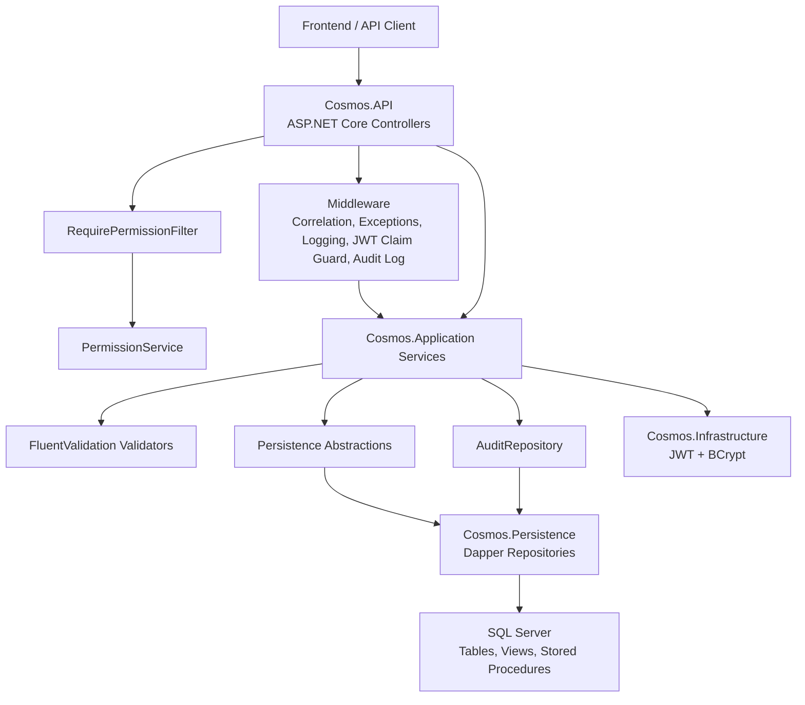
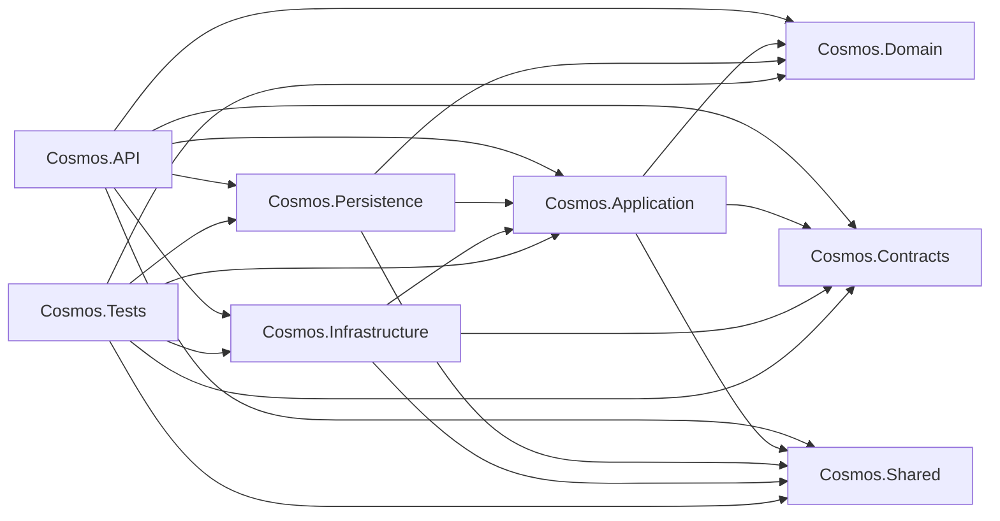
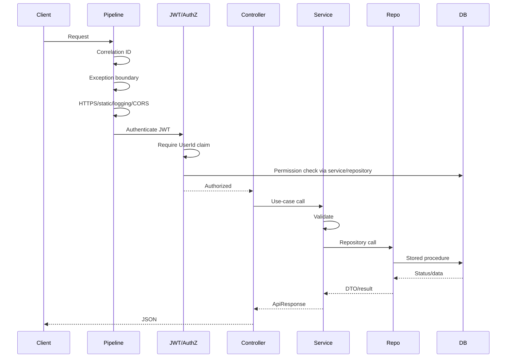
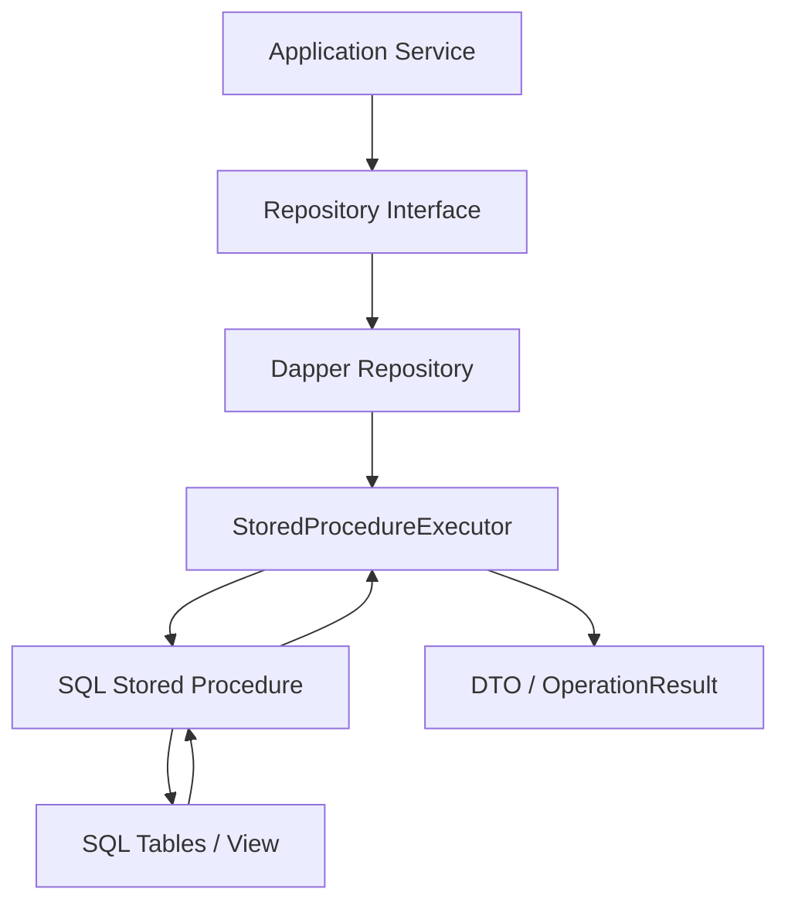
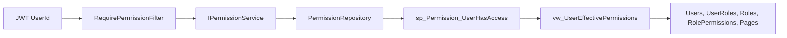
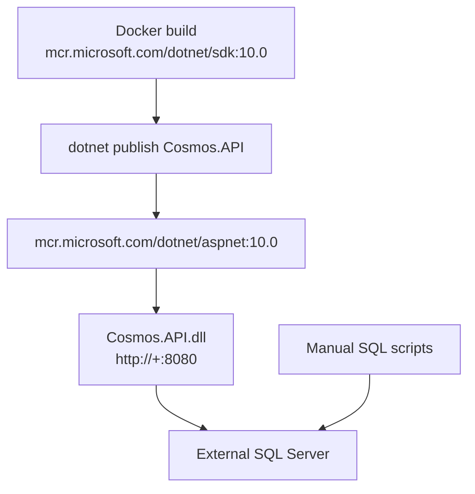

# System Architecture

## High-Level View

## Project Dependency Model

## Runtime Request Pipeline

Order in `Program.cs`:
1. `CorrelationIdMiddleware`
2. `GlobalExceptionMiddleware`
3. `UseHsts` outside Development
4. `UseSwagger` and `UseSwaggerUI`
5. `UseHttpsRedirection`
6. `UseStaticFiles`
7. `UseSerilogRequestLogging`
8. `RequestLoggingMiddleware`
9. `UseCors("CorsPolicy")`
10. `UseAuthentication`
11. `JwtClaimsMiddleware`
12. `UseAuthorization`
13. `AuditMiddleware`
14. `MapControllers`
15. `MapHealthChecks("/health")`

## Data Architecture

- Primary database: SQL Server.
- Application data access style: Dapper against stored procedures.
- Schema management style: idempotent SQL scripts in `database/`.
- Result convention:
  - Plain read procedures return result sets.
  - Mutating procedures usually return first row `OperationResult(StatusCode, Message)` and then a DTO row.
  - `StoredProcedureExecutor.QueryWithStatusAsync<T>` throws `CosmosException` on non-2xx status.

## Security Architecture

- Authentication:
  - Login validates BCrypt hash stored in `Users.PasswordHash`.
  - Access token is a JWT signed with configured symmetric signing key.
  - Refresh tokens are generated as 64 random bytes converted to base64 and stored in `RefreshTokens`.
- Authorization:
  - JWT contains identity only: `UserId`, `Username`, `Email`, JTI.
  - Roles and permissions are database state.
  - `[RequirePermission]` checks page/action permissions through SQL.
- Effective permissions:
  - `vw_UserEffectivePermissions` joins active users, roles, role permissions, and pages.
  - `sp_Permission_UserHasAccess` checks the requested `PermissionAction`.

## Module Boundaries

| Module | API Boundary | Service | Repository | SQL Script |
|---|---|---|---|---|
| Auth | `AuthController` | `AuthService` | `AuthRepository`, `UserRepository` | `database/CosmosERP.Security.sql` |
| Users | `UsersController` | `UserService` | `UserRepository` | `database/CosmosERP.Security.sql` |
| Roles | `RolesController` | `RoleService` | `RoleRepository` | `database/CosmosERP.Security.sql` |
| Permissions | `PermissionsController`, filter | `PermissionService` | `PermissionRepository` | `database/CosmosERP.Security.sql` |
| Pages | `PagesController` | `PageService` | `PageRepository` | `database/CosmosERP.Security.sql` |
| Parties | `PartiesController` | `PartyService` | `PartyRepository` | `database/001_Party_Module.sql` |
| Party Settings | `PartySettingsController` | `PartySettingsService` | `PartySettingsRepository` | `database/001_Party_Module.sql` |
| Categories | `CategoriesController` | `CategoryService` | `CategoryRepository` | `database/Scripts/002_ItemModule.sql` |
| Units | `UnitsController` | `UnitService` | `UnitRepository` | `database/Scripts/002_ItemModule.sql` |
| Items | `ItemsController` | `ItemService` | `ItemRepository` | `database/Scripts/002_ItemModule.sql` |
| HRMS | `Controllers/HR/*` | `HrService` | `HrRepository` | `database/Scripts/HR/001_HRMS_Module.sql` |

## Deployment Architecture

Current deployment evidence:
- Dockerfile builds only the API publish artifact.
- Database scripts are separate and must be applied outside the container.
- Runtime environment defaults to Production and port 8080.
- No reverse proxy, Kubernetes, CI/CD, or database migration automation is present in the repository.

## Observability

- Serilog configured from appsettings and enriched from log context.
- Console and rolling file sink configured.
- Request duration logged through both Serilog request logging and custom request logging middleware.
- Correlation ID is added to logs and response header.
- Health endpoint exists at `/health`, but no SQL dependency health check is registered.

## Background Processing

No in-process background services, workers, queues, schedulers, SignalR hubs, gRPC services, or hosted services were found.
