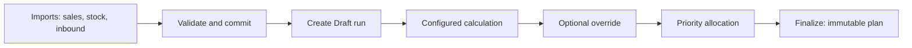

# COSMOS Dispatch test data and workflow guide

## Purpose and scope

Dispatch Planning turns committed, warehouse-level sales and stock snapshots into recommended replenishment quantities. The existing configured policy is used; the Excel-parity engine is not registered or invoked. A run progresses from **Draft (1)** to **Calculated (2)**, **Allocated (3)**, then **Finalized (4)**; it may be **Cancelled (5)**. Finalization does not mutate `Items.CurrentStock`.

This guide covers a small, isolated scenario in `CosmosDispatchIntegrationTests_20261012`. It is never suitable for production.



## Executed test-data inventory

The seed script was executed on 2026-10-14 against `(localdb)\MSSQLLocalDB`, database `CosmosDispatchIntegrationTests_20261012`. The read-only verifier returned `READY`.

| Record | Identifiers | Starting values | Purpose / expected behavior |
|---|---|---|---|
| Channel | `DSPTEST`, ID 5 | two active warehouses | isolated UI filter and mapping scope |
| Warehouses | `DSPTEST-WH-A` ID 3, `DSPTEST-WH-B` ID 4 | priority 0 then 1 | allocation order tiebreaker |
| Shortage item | `DSPTEST-SHORT`, ID 2 | company stock 20; box size 6; round-up mode | produces warehouse recommendations and constrained allocation |
| Sufficient item | `DSPTEST-SUFFICIENT`, ID 3 | company stock 100; box size 10 | produces zero recommendation |
| Sales batch | ID 5, `DSPTEST-sales-20261007.json` | short sales: A=10, B=20; sufficient A=8 | calculation demand input |
| Stock batch | ID 6, `DSPTEST-stock-20261007.json` | short stock: A=2, B=1; sufficient A=100 | current sellable stock input |
| Inbound batch | ID 7, `DSPTEST-inbound-20261007.json` | A=3, status Dispatched; B=9, status Planned | only statuses 2/3 are eligible |

## Calculation walkthrough

`DispatchCalculationService` calculates `recurring = sales × recurringDemandFactor`, `safety = recurring × safetyStockFactor`, and `shortage = max(0, recurring + safety - (sellable + eligible inbound))`. The `DSPTEST-SHORT` setting has factors 1 and 0.1, six units per box, and `RoundUpToBox`.

| Warehouse / SKU | Sales | Sellable | Eligible inbound | Reorder point | Raw shortage | Expected configured recommendation |
|---|---:|---:|---:|---:|---:|---:|
| A / `DSPTEST-SHORT-SKU` | 10 | 2 | 3 | 11 | 6 | 6 |
| B / `DSPTEST-SHORT-SKU` | 20 | 1 | 0 (Planned excluded) | 22 | 21 | 24 (rounded up from 3.5 boxes) |
| A / `DSPTEST-SUFFICIENT-SKU` | 8 | 100 | 0 | 8.8 | 0 | 0 |

Company stock for the shortage item is 20. Allocation uses priority, tier, warehouse priority and recommendation ID: A should receive 6 first; B can then receive 14 of its requested 24. These values are expected only after you create and calculate the run through the application.

## UI walkthrough

1. Configure the development API and web application to use only `CosmosDispatchIntegrationTests_20261012`; sign in with Dispatch permissions.
2. Open **Dispatch Planning → Imports** (`/dispatch/imports`), choose History, filter Channel **DSPTEST**, and confirm the three committed batches above.
3. Open **Dispatch Planning → Runs** (`/dispatch/runs`), choose **New dispatch planning run**, select DSPTEST, planning date `2026-10-07`, Sales batch 5, Stock batch 6, and Inbound batch 7. Add a note beginning `DSPTEST` so verification and cleanup can identify it.
4. Open the created run and choose **Calculate**. Confirm the three result lines and quantities above. The service/API is `POST /api/v1/dispatch-planning/runs/{id}/calculate`.
5. While status is Calculated, edit a recommendation to demonstrate `PATCH /api/v1/dispatch-planning/runs/{runId}/recommendations/{recommendationId}`. An override reason is required.
6. Choose **Allocate**. The application uses `DispatchAllocationService`, then `POST /api/v1/dispatch-planning/runs/{id}/allocate`; inspect allocated quantities.
7. Choose **Finalize** only after allocation. The API is `POST /api/v1/dispatch-planning/runs/{id}/finalize`; status becomes Finalized and results are immutable.
8. Open **Dispatch Planning → Reports** (`/dispatch/reports`) to view finalized recommendations.

The UI route labels in source are Dashboard (`/dispatch/dashboard`), Runs, Imports, Settings, and Reports. Imports supports both CSV and **Manual entry**. No browser/UI session was available for this task, so these UI actions have not been marked passed.

## API and persistence map

| Action | Endpoint / service | Main persisted entities |
|---|---|---|
| Validate/commit import | `/api/v1/dispatch-planning/imports/*`; `usp_DispatchPlanning_Import_Validate/Commit` | `SupplyChainImportBatches`, staged rows, sales/stock/inbound snapshots |
| Create run | `POST /runs`; `usp_DispatchPlanning_Run_Create` | `DispatchPlanningRuns` |
| Calculate | `POST /runs/{id}/calculate`; `DispatchCalculationService` | recommendations plus immutable company-stock snapshots |
| Override | `PATCH /runs/{run}/recommendations/{id}` | `DispatchRecommendationResults` |
| Allocate | `POST /runs/{id}/allocate`; `DispatchAllocationService` | `DispatchAllocations`, result allocation quantities |
| Finalize | `POST /runs/{id}/finalize` | finalized run timestamp/status only |

The key links are Channel → Warehouses / SKU mappings; Import batch → snapshot rows; Run → source batch IDs; Run → recommendations/company-stock snapshots → allocations.

## Validation and troubleshooting

To demonstrate rejection without corrupting valid data, use Imports → Manual entry, select DSPTEST and Sales, enter `DSPTEST-NO-MAP` as Channel SKU, and validate. It should return `No active Channel Item Mapping exists for this exact Channel SKU`; do not commit it. Valid DSPTEST batches remain unchanged.

- If batches are absent, ensure the UI/API is connected to the named LocalDB database and filter Channel `DSPTEST`.
- If calculation says there are no eligible rows, confirm all three batches are Committed, selected on the run, settings are active, and their effective dates include `2026-10-07`.
- If Allocate/Finalize is disabled, inspect run status: override requires Calculated; finalize requires Allocated.
- A 403 means the signed-in user lacks the relevant `DispatchPlanning.*` permission.

## Scripts, verification, cleanup

Run from the repository root only after checking the database name:

```powershell
sqlcmd -S "(localdb)\MSSQLLocalDB" -E -d "CosmosDispatchIntegrationTests_20261012" -b -i backend/database/dispatch_test_data/dispatch_test_data_seed.sql
sqlcmd -S "(localdb)\MSSQLLocalDB" -E -d "CosmosDispatchIntegrationTests_20261012" -b -i backend/database/dispatch_test_data/dispatch_test_data_verify.sql
```

All scripts refuse any database not named `CosmosDispatchIntegrationTests_*`. Cleanup refuses if a `DSPTEST` run exists, because lifecycle/audit rows must not be deleted directly. Cancel/handle that run through the application or recreate the disposable database, then run `dispatch_test_data_cleanup.sql`.

## Files inspected

Backend: Dispatch controllers, `DispatchPlanningService`, calculation/allocation services, repository/contracts/validators, and migrations `20260728` / `20261008`. Frontend: Dispatch routes, Imports, Runs/Run Detail, Settings, Reports, API services, sidebar and lifecycle helpers. Existing configured-policy LocalDB integration scripts were reused as the safe data-flow reference.
