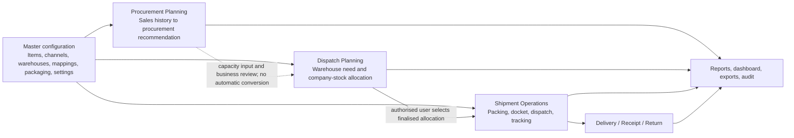
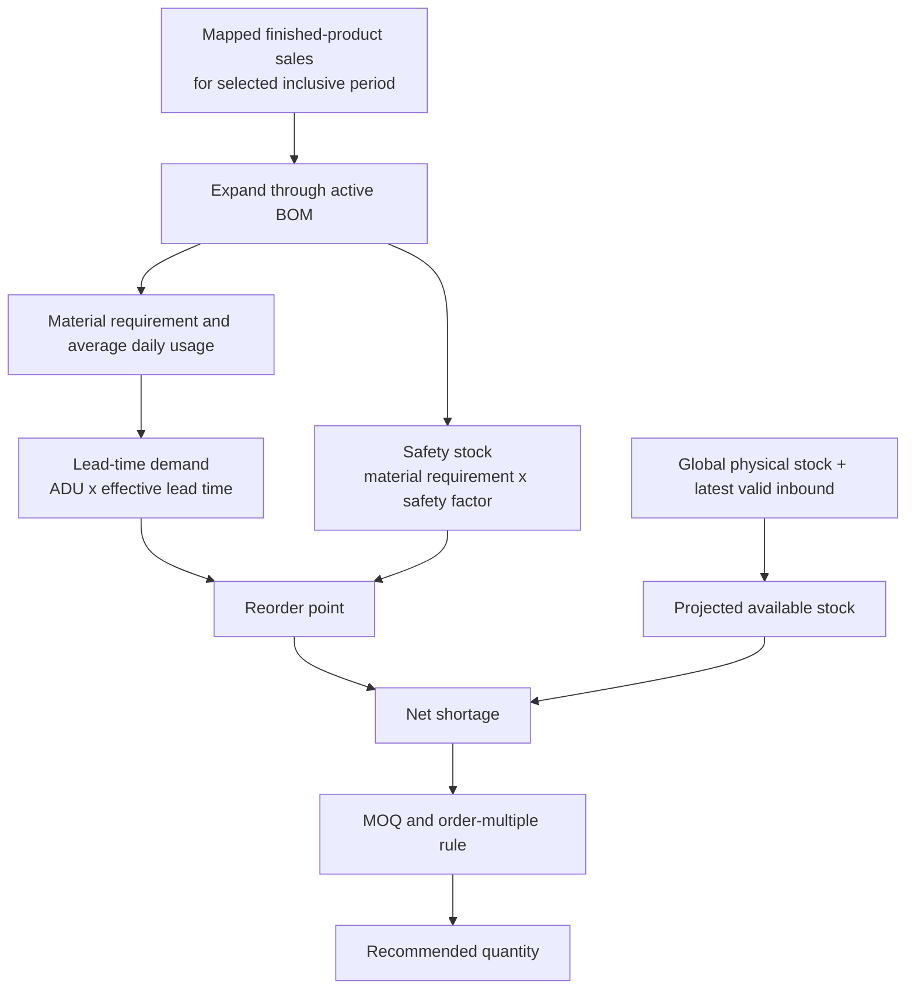
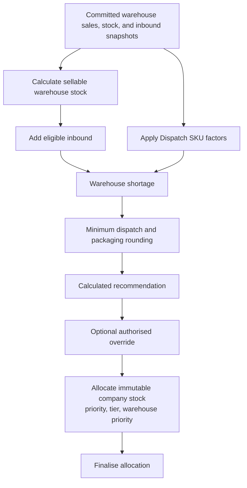
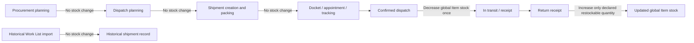
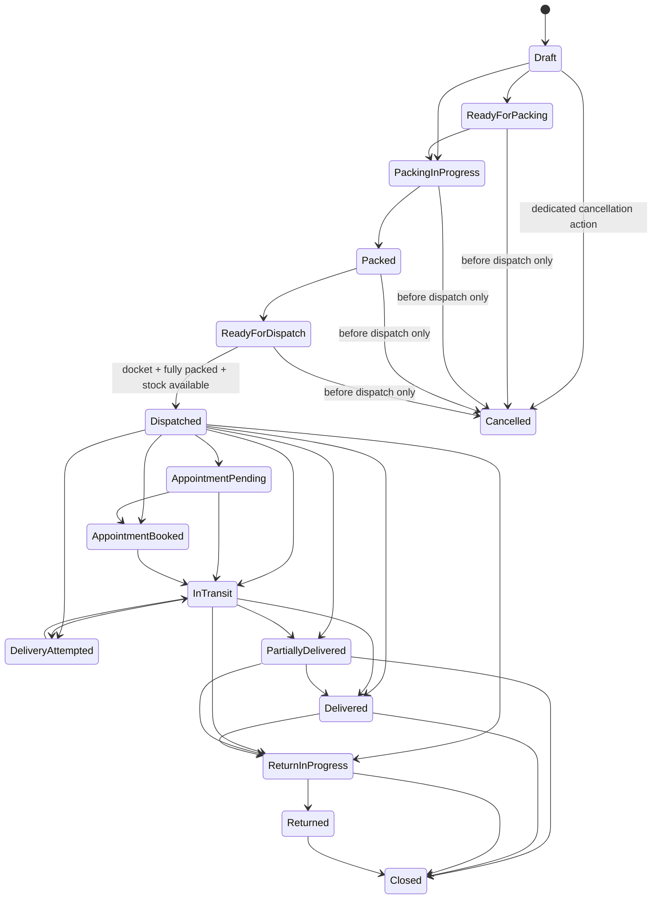

# COSMOS ERP Supply Chain Client Handover Guide

**Modules covered:** Procurement Planning, Dispatch Planning, and Shipment Operations / Work List

**Audience:** business owner, operations manager, procurement team, dispatch team, warehouse team, shipment coordinator, ERP administrator, and implementation/support team.

**Document status:** repository-based handover guide, prepared 2026-08-03.

## 1. Document Purpose

This guide explains the operating model for the three COSMOS ERP modules that replace spreadsheet-based supply-chain planning and shipment tracking:

- **Procurement Planning** turns channel sales history into auditable recommendations for materials or products to arrange or procure.
- **Dispatch Planning** turns channel and warehouse requirements into an auditable plan for distributing available company stock.
- **Shipment Operations / Work List** manages the physical execution and tracking of shipments after planning.

Together, they replace manual consolidation, calculations, version control, and follow-up in spreadsheets with controlled records, validation, permissions, snapshots, and audit history. They do not remove the need for business review: the ERP records the configured rules and the decisions made by authorised users.

### How to read this guide

The guide uses the following labels deliberately:

| Label | Meaning |
| --- | --- |
| **Implemented** | Behaviour confirmed in the current repository. |
| **Configurable** | A master-data value or policy that authorised users or support staff must set. |
| **Client confirmation** | A decision that must be agreed with the client before production use. |
| **Future phase** | Useful capability not implemented in this release. |

> **Workbook basis notice**
>
> The modules were implemented using the confirmed business workflow and available project documentation. Worksheet-specific formulas, labels, factors, tiers, and rounding rules must be confirmed during client validation.
>
> A Procurement workbook was assessed indirectly through the supplied migration report. The original Dispatch Scheduling and Work List workbooks were not available in the repository or attachment set. Therefore, this guide does not claim cell-by-cell parity for those workbooks.

## 2. Complete Business Flow Overview

The modules are connected, but each has a separate responsibility. A procurement recommendation is not a purchase order. A dispatch plan is not a stock movement. A shipment is the execution record that can change stock when dispatch is confirmed.

1. Configure Items, sales channels, channel warehouses, channel SKU mappings, packaging, BOMs, and operating settings.
2. Import or enter historical sales and stock information.
3. Calculate procurement requirements from sales history and material configuration.
4. Review, adjust where permitted, and finalise procurement recommendations.
5. Capture channel/warehouse sales, stock, and inbound snapshots for dispatch planning.
6. Create a dispatch planning run and capture its immutable company-stock basis.
7. Calculate channel-warehouse requirements and allocate the available company stock.
8. Finalise the dispatch plan.
9. Create a shipment manually or by selecting remaining quantities from a finalised dispatch allocation.
10. Pack goods and record packages, docket, transporter, and appointments where required.
11. Confirm dispatch. This is the normal outbound stock-impact point.
12. Track movement and delivery attempts, then record receipt outcomes.
13. Record return details and receive returned goods. Only an eligible restockable return receipt increases stock.
14. Review reports, dashboard figures, exports, and audit history.



## 3. Shared Supply Chain Foundation

The three modules use a common foundation so that a SKU, warehouse, packaging rule, and imported record have the same meaning throughout the process.

| Shared data | What it represents | Why it is needed | Normal owner | If missing or incorrect |
| --- | --- | --- | --- | --- |
| Item master | The COSMOS record for a saleable product, material, component, or packing material. | It is the single identity used by BOMs, stock, recommendations, allocations, and shipments. | Item Master Administrator | Imports cannot reliably match; calculations or stock actions may be blocked or wrong. |
| Sales channels | Marketplace or selling channel, such as the seeded AMZ, BLI, and INS records. | Separates channel demand and channel SKUs. | Administrator / commercial operations | Channel imports and warehouse relationships cannot be validated. |
| Channel warehouses | A destination warehouse belonging to a channel, with priority and address details. | Dispatch and shipments need a valid destination. | Dispatch / warehouse master owner | Dispatch import, planning, and shipment creation are blocked for that destination. |
| Channel SKU mappings | The explicit mapping from a channel SKU to an existing COSMOS Item, including effective dates and primary mapping where relevant. | Prevents product-name guessing and makes imported data traceable. | Item Master Administrator | The SKU is shown as unmatched; Procurement Planning is blocked by unresolved sales, and dispatch/import validation fails where exact mapping is required. |
| Item packaging profiles | Units per box, dimensions, weight units, weights, and optional volumetric divisor; may be global or channel-specific. | Dispatch rounding and shipment packing use the chosen profile. | Warehouse / packaging master owner | Dispatch calculation may be incomplete; package suggestions and shipment details may be unreliable. |
| Shared import batches and rows | Staged imported data with file identity, row errors, duplicate protection, timestamps, and audit context. | Lets users validate before committing business data. | Procurement / Dispatch team | No approved input is available; correction and traceability are weakened. |
| Company stock | The current global on-hand quantity in the existing Item master. | Procurement uses it as part of projected availability; Dispatch snapshots it for allocation; confirmed shipment dispatch deducts it. | Warehouse / inventory owner | Recommendations and dispatch stock checks may be incorrect. This is not warehouse/bin stock. |
| Channel/warehouse stock snapshots | Warehouse stock facts: available, reserved, damaged, and calculated sellable quantity. | Dispatch calculates destination need from these snapshots. | Dispatch team / channel operations | The dispatch run cannot be based on a complete, reliable destination stock picture. |
| Inbound snapshots | Procurement inbound availability, and Dispatch warehouse inbound records with a status. | Prevents counting only stock already on hand when valid inbound is relevant. | Procurement / Dispatch team | Procurement projected availability or Dispatch destination stock may be understated or overstated. |
| Audit history | Who changed records, when, and what business action occurred. | Supports accountability, troubleshooting, and handover. | Administrator / Auditor | Investigations and support are harder; users should not work around the audit trail. |
| Role and permission controls | Page/action access for each module area. | Keeps configuration, approvals, exports, and stock-impact actions with the right people. | System Administrator | Users are denied actions, or excessive access may be granted. |

### Master-data readiness checklist

- [ ] All saleable finished products, materials, components, and packing materials exist as active Items.
- [ ] Items that Procurement uses have the correct procurement classification.
- [ ] Every channel SKU is mapped to the correct Item; product names alone have not been used as identity.
- [ ] Each active destination warehouse is linked to the correct channel and has an agreed priority.
- [ ] Packaging profiles contain confirmed units per box, dimensions, weight units, gross/net weights, and any volumetric divisor.
- [ ] A valid BOM exists for each sold finished product that needs material planning.
- [ ] Procurement lead time, safety factor, MOQ, order multiple, manual-planning, and rounding settings are confirmed.
- [ ] Dispatch SKU settings, factors, tier, rounding mode, loose-quantity rule, and allocation priority are confirmed.
- [ ] Company stock and destination warehouse snapshots are current and reviewed by the accountable team.
- [ ] Procurement inbound validity and Dispatch inbound status treatment are agreed.
- [ ] Transporter parties are active and explicitly assigned the Transporter role before use.
- [ ] User roles have the required module page/action permissions.

## 4. Operating Model and Workbook Interpretation

The current repository contains APIs, permissions, validation, audit trails, calculation engines, database procedures, and exports for these modules. It does **not** contain the corresponding React user screens for Procurement Planning, Supply Chain foundation, Dispatch Planning, or Shipment Operations. The page names in this guide are permission/navigation records, not evidence of a finished front-end screen.

Until those screens or an approved client interface are delivered, authorised users will operate the module through the secured API/integration interface or an implementation/support-led process. The business workflows, validations, lifecycle rules, reports, and exports in this guide remain the authoritative backend behaviour.

The original Dispatch Scheduling and Work List workbooks were unavailable. The client must provide those workbooks before migrating historical warehouse, packaging, shipment, freight, or formula-specific data. No warehouse, shipment, transporter, or Item was auto-created from workbook text.

## 5. Common Data-Control Principles

1. **Validate before commit.** Import batches retain row-level errors and duplicate information before business records are committed.
2. **Use explicit identities.** Matching is through active channel SKU mappings, not a guessed product name.
3. **Preserve the basis of a decision.** Procurement runs store their input/result snapshot; Dispatch runs preserve company-stock snapshots; Shipment records retain operational snapshots such as item, SKU, warehouse, and packaging details.
4. **Use a reason for exceptions.** Duplicate corrections, cancellations, procurement line adjustments, and dispatch overrides require an explanation where the module supports the action.
5. **Do not silently change history.** Finalised plans are immutable. Shipment tracking events are append-only. A correction should use the available cancellation, new run, return, or new record process.

## 6. Procurement Planning Module

### 6.1 Business Purpose

**Implemented:** Procurement Planning answers: **"What material or product should we arrange or procure for the selected period?"**

It uses:

- Historical channel sales of finished products
- Explicit channel-SKU-to-Item mappings
- Finished-product BOM expansion
- Global physical Item stock
- The latest valid inbound snapshot on or before the planning end date
- Lead time, safety factor, MOQ, order multiple, rounding, and Item planning settings

It produces a recommendation and an auditable planning snapshot. It does **not** create a purchase order, purchase bill, supplier balance change, stock movement, accounting entry, or automatic approval.

### 6.2 Sheet Process Replaced

The module replaces the spreadsheet activities of collecting channel sales, matching marketplace SKUs, expanding finished products into component requirements, reviewing stock and inbound availability, calculating shortages, applying safety and ordering rules, and preparing a recommended procurement quantity.

The available Procurement migration report records a compatibility assessment for the supplied source material. It also identifies workbook helper-stock and formula-reference defects that were not copied into the ERP calculation. Exact cell-by-cell parity must not be assumed outside the documented report.

### 6.3 Required Configuration

| Configuration | Business meaning |
| --- | --- |
| Procurement classification | Identifies finished products, raw materials, components, or packing materials without changing the existing Item stock type. |
| Channel SKU mapping | Identifies the finished product behind each imported marketplace SKU. |
| BOM | States how much of each material/component is required for one finished product. |
| Lead time | The source is selected in this order: Item override, average receipt history, then configured value. |
| Safety factor | The confirmed factor used to calculate safety stock from material requirement. |
| MOQ and order multiple | Minimum order quantity and, when configured, the quantity multiple used for upward rounding. |
| Planning flags | Automatic calculation can be disabled; manual-planning items remain visible but receive no automatic suggestion. |
| Global current stock | The current Item on-hand quantity. Reservations are excluded from this module's calculation basis. |
| Valid inbound snapshot | The latest valid inbound quantity at or before the planning end date. |
| Sales import mapping | The expected import fields are SalesDate, ChannelCode, ChannelSku, optional ChannelProductName, and Quantity. |

**Important implementation note:** the calculation can use inbound snapshots, but no public Procurement inbound-snapshot maintenance endpoint was identified in the reviewed controllers. Before go-live, agree the approved administrator/support process for loading and validating inbound snapshots.

### 6.4 Operational Workflow

1. Confirm the master-data readiness checklist.
2. Import a CSV or XLSX sales file, or record an authorised manual sales correction.
3. Review validation results, including invalid rows, duplicates, and unmapped SKUs.
4. Correct invalid rows and create explicit SKU mappings. Unmapped sales may be retained but block planning until resolved.
5. Commit the import. A duplicate file needs an explicit correction reason.
6. Confirm BOM, procurement settings, physical stock, and inbound snapshot data.
7. Select an inclusive planning date range (maximum 366 days) and validate the planning prerequisites.
8. Preview the calculation and review blocking errors, warnings, inputs, shortages, and recommendations.
9. Save a recalculated snapshot as a **Draft** planning run. Saving is blocked when there are blocking errors.
10. Adjust a Draft line only where authorised. If final quantity differs from the calculated quantity, provide a reason.
11. Finalise the run when the procurement team accepts it.
12. Export the stored plan as an XLSX file and use it as the controlled input for procurement action outside this module.

| Run state | Implemented behaviour |
| --- | --- |
| Draft | Created when a valid calculation is saved. Draft quantities can be adjusted with an exception reason. |
| Finalized | Locked snapshot. It cannot be adjusted or cancelled through the implemented workflow. |
| Cancelled | A reason is required. Draft and supported calculation/review compatibility states may be cancelled; a finalised run may not. |

The domain also contains Calculated and Reviewed compatibility states, but no separate current API action was found that moves a newly saved Procurement run into either state. Operational users should work with the implemented Draft, Finalized, and Cancelled actions.

### 6.5 Calculation Explanation

The implementation calculates material requirement from valid mapped finished-product sales and their active BOM components. It then derives average daily usage and uses the selected lead time and safety factor.



In business terms:

| Term | Meaning in the implemented calculation |
| --- | --- |
| Physical stock | Global `Items.CurrentStock`; it is not warehouse-specific stock. |
| Inbound stock | Latest valid inbound quantity on or before the planning end date. |
| Projected available stock | Physical stock plus valid inbound stock. |
| Material requirement | Finished-product sales expanded through BOM quantities. |
| Average daily usage | Material requirement divided by the inclusive number of planning days. |
| Lead-time demand | Average daily usage multiplied by the effective lead time. |
| Safety stock | Material requirement multiplied by the configured safety factor. |
| Reorder point | Lead-time demand plus safety stock. |
| Net shortage | The positive difference between reorder point and projected available stock. |
| MOQ | The configured minimum order quantity. |
| Order multiple | Optional upward rounding multiple when the approved rounding setting applies. |
| Final recommended quantity | The automatic result, or an authorised Draft override with a reason. |

Conceptually:

```text
Demand from sales history and BOM
+ safety requirement
- physical stock
- valid inbound quantity
= net requirement before ordering rules
```

MOQ and order-multiple rules can increase the result. The exact engine also retains the workbook-compatible rule that stock equal to the reorder point follows the MOQ branch rather than returning zero.

**Illustrative example only - not a replacement for configured rules:** If a material has a reorder point of 150, physical stock of 80, valid inbound of 20, and an MOQ of 75, its projected availability is 100 and shortage is 50. The recommendation is at least 75 because MOQ is higher than the shortage. If the approved order multiple is 40, the final recommendation may be rounded up to 80.

### 6.6 Outputs

Verified outputs are:

- Sales import template, preview, batch history, and row-level validation results
- Manual sales history and channel/product sales summary
- BOM and missing-configuration issue visibility
- Procurement setting and lead-time history visibility
- Non-persistent validation and planning preview
- Draft, finalised, or cancelled planning-run snapshots with item/material-level results
- Shortage, inbound stock, projected availability, calculation explanation, and override reason in the stored line snapshot
- True XLSX export of a saved planning run
- Audit events for master-data changes, imports, planning saves, adjustments, finalisation, and cancellation

### 6.7 Procurement Permissions

The following are client-facing permission areas. The exact keys appear in the technical appendix.

| Page / area | Business purpose | Typical actions implemented |
| --- | --- | --- |
| Sales Import | Import, correct, review, and cancel sales history; maintain manual sales. | View, Create, Edit, Delete |
| Channel SKU Mapping | Resolve marketplace SKU identity. | View, Create, Edit |
| BOM Mapping | Maintain product-to-material/component relationships. | View, Edit |
| Procurement Settings | Maintain lead time, safety, MOQ, multiple, and planning flags. | View, Edit |
| Generate Plan | Validate, preview, and save a draft. | View, Create |
| Planning History | Review snapshots, adjust Draft lines, finalise, cancel, and export. | View, Edit, Delete, Approve, Export |

### 6.8 Procurement Client Confirmation Points

- Confirm all real channel SKUs and Item matches.
- Confirm BOM quantities and material units.
- Confirm lead-time source, safety factors, MOQ, order multiples, and manual-planning items.
- Confirm whether source workbook EOQ values should be treated as MOQ.
- Confirm the business interpretation and validity rules for inbound stock.
- Confirm whether global Item stock is acceptable while a location-aware stock model is unavailable.
- Confirm any channel-specific formulas not contained in the reviewed calculation engine.
- Confirm the operational owner and load method for inbound snapshots before production use.

## 7. Dispatch Planning Module

### 7.1 Business Purpose

**Implemented:** Dispatch Planning answers: **"How should available company stock be distributed to each channel warehouse?"**

Procurement Planning focuses on what may need to be arranged or procured. Dispatch Planning focuses on the quantity to send, its channel and destination warehouse, and how limited company stock is allocated across competing recommendations.

Planning, calculation, allocation, finalisation, and cancellation do **not** update Item stock, StockMovements, shipments, purchase orders, freight, or Rojmel records.

### 7.2 Sheet Process Replaced

The module replaces manual consolidation of warehouse sales/requirements, warehouse stock, inbound stock, company stock, packaging quantities, allocation decisions, shortages, and dispatch-plan exports.

The original Dispatch Scheduling workbook was not supplied. The system implements the confirmed workflow and configurable policies, but does not claim the exact meaning of workbook factors, tiers, or rounding boundaries.

### 7.3 Required Configuration

| Configuration / input | Business meaning |
| --- | --- |
| Sales channels and channel warehouses | The channel and valid destinations for a run. Warehouse priority participates in deterministic allocation order. |
| Channel SKU mappings | Exact active SKU-to-Item match used by snapshots; no Item code or product-name fallback is used. |
| Dispatch SKU settings | Effective-dated global or channel-specific policy: tier, factors, minimum quantity, loose quantity, rounding mode, allocation priority, and optional preferred packaging profile. |
| Packaging profile | Units per box and related packaging detail. Selection is setting-specific profile, then active channel default, then active global default. |
| Warehouse sales snapshot | Recent sales quantity and its period for the selected channel warehouse. |
| Warehouse stock snapshot | Available, reserved, and damaged quantity. Sellable quantity is available minus reserved minus damaged, never below zero. |
| Warehouse inbound snapshot | Inbound quantity, reference, expected arrival, and inbound status. Only Dispatched and InTransit are eligible for the calculation. |
| Company-stock snapshot | Immutable copy of the released system company-stock basis for the run. In this release the only source is read-only global system stock. |
| Permissions | Controls settings, snapshot imports, run operations, allocation, reports, and export. |

### 7.4 Operational Workflow

1. Configure channels, destination warehouses, exact SKU mappings, packaging profiles, and Dispatch SKU settings.
2. Prepare typed warehouse sales, stock, and optional inbound snapshots for one channel, either by CSV import or Manual Entry.
3. Validate CSV rows or the manual warehouse/SKU entry. Correct invalid, mismatched, duplicate, or unmapped SKU rows.
4. Commit valid snapshot batches. Only committed batches can be used in a planning run.
5. Create a **Draft** dispatch run with the selected channel, planning date, committed sales batch, committed warehouse-stock batch, optional inbound batch, and system company-stock source.
6. The system captures immutable company-stock snapshots for the run.
7. Calculate recommendations. Missing active settings or packaging profiles must be corrected before a complete result can be generated.
8. Review warehouse-level demand, stock basis, shortage, rounding result, and calculation explanation.
9. Apply a permitted override only while the run is **Calculated**; every override needs a reason.
10. Allocate company-stock snapshots. Review full, partial, and zero allocations.
11. Finalise the **Allocated** run. It becomes read-only and may be used as the source for selected shipment conversion.
12. Export the finalised recommendation report as CSV, or use the finalised allocations to create shipments through an authorised user action.

| Run state | Allowed operational behaviour |
| --- | --- |
| Draft | Can be calculated or cancelled. |
| Calculated | Can be recalculated, overridden, allocated, or cancelled. |
| Allocated | Can be finalised or cancelled; it cannot be overridden. |
| Finalized | Immutable; no cancellation, edit, or stock deduction occurs in Dispatch Planning. |
| Cancelled | Retained as an auditable cancelled run with reason. |

### 7.5 Allocation Logic

For each Item and channel warehouse, the calculation uses the implemented business logic below:

```text
Total warehouse stock = sellable warehouse stock + eligible inbound
Recurring demand      = warehouse sales x recurring-demand factor
Safety stock          = recurring demand x safety-stock factor
Reorder point         = recurring demand + safety stock
Raw shortage          = max(0, reorder point - total warehouse stock)
Pre-rounded quantity  = max(raw shortage, minimum dispatch quantity)
Recommendation        = packaging/loose-quantity rounding result
```

| Term | Meaning |
| --- | --- |
| Demand / target | The calculated recommendation for one Item at one destination warehouse. |
| Warehouse stock | Sellable warehouse quantity after reserved and damaged quantities are excluded. |
| Eligible inbound | Inbound only in Dispatched or InTransit status. Planned, Received, and Cancelled inbound do not count. |
| Company stock | The immutable global system-stock snapshot used to allocate the run. |
| Packaging quantity | Units per box from the selected packaging profile. |
| Allocation priority | Lower allocation priority is served first, then Tier 1/2/3, warehouse priority, and a stable result order. |
| Partial allocation | A warehouse may receive less than its final recommendation if company stock is insufficient. |
| Unallocated shortage | The portion of the recommendation that did not receive company-stock allocation. |
| Rounding mode | Exact, Nearest Box, Round Up to Box, Round Down to Box, Exact Below One Box, or Half Box Threshold. Loose quantities bypass box rounding. |
| Manual override | Authorised non-negative final recommendation quantity with a compulsory reason before allocation. |

**Client confirmation:** Tier is implemented as part of the allocation ordering. The repository does not establish whether a client workbook's tier also changes quantity, factors, or business eligibility. The client must confirm that meaning, the gross-versus-sellable stock interpretation, factor values, and rounding semantics.



### 7.6 Stock Snapshot Principle

The company-stock snapshot is immutable because it preserves the exact basis used for allocation. Later changes to current stock do not silently rewrite an earlier recommendation. This makes the plan reproducible and auditable.

Dispatch Planning itself does not reduce physical stock. Its finalised allocation is a controlled recommendation allocation, not a warehouse reservation or an inventory movement. The Shipment Operations module performs the later current-stock check again at confirmed dispatch.

### 7.7 Outputs

Verified outputs are:

- Dispatch SKU settings and committed snapshot-batch history
- Draft, calculated, allocated, finalised, and cancelled planning runs
- Warehouse-level recommendations, calculated/final quantities, box count, and calculation explanation
- Immutable company-stock snapshots and allocation results
- Override reason and audit history
- Finalised recommendation report with channel, warehouse, Item, channel SKU, tier, recommended quantity, allocated quantity, and box count
- CSV export of up to 500 filtered recommendation-report rows

### 7.8 Dispatch Permissions

| Page / area | Business purpose | Typical actions implemented |
| --- | --- | --- |
| Dispatch SKU Settings | Maintain effective-dated dispatch policy. | View, Create, Edit, Delete |
| Dispatch Imports | Validate, commit, view, or cancel Dispatch snapshot batches. | View, Create, Delete |
| Dispatch Planning Runs | Create, calculate, review, override, finalise, or cancel runs. | View, Create, Edit, Delete, Approve |
| Dispatch Allocation | Allocate company-stock snapshots to recommendations. | Edit |
| Dispatch Reports | Review finalised recommendations and export CSV. | View, Export |

### 7.9 Dispatch Client Confirmation Points

- Confirm whether incoming warehouse stock is gross or already sellable/net stock.
- Confirm channel and warehouse priority values and the business meaning of Tier 1/2/3.
- Confirm recurring-demand and safety-stock factors per Item/channel.
- Confirm packaging, loose-quantity, and rounding rules, especially half-box midpoint treatment.
- Confirm the timing of the company-stock snapshot and acceptable re-planning/cancellation policy.
- Confirm inbound interpretation and whether any Planned inbound should count in a particular client process.
- Confirm the policy for partial allocations and unallocated shortages.
- Confirm the source-format adapter for Dispatch snapshots; no direct Dispatch CSV/XLSX upload endpoint was verified in this module.

## 8. Shipment Operations / Work List Module

### 8.1 Business Purpose

Shipment Operations manages execution after planning. It replaces the manual Work List used to follow a shipment through creation, packing, docket preparation, appointment activity, dispatch, tracking, receipt, returns, freight, dashboard review, reporting, and historical import.

A shipment may be created manually, with a recorded manual reason, or from remaining quantity in a **finalised** Dispatch Planning allocation. The latter is a user-initiated conversion; the system does not automatically generate shipments from every dispatch recommendation.

### 8.2 Important Stock Rule

> **Stock-impact rule - operationally critical**
>
> - Creating a shipment does not change inventory.
> - Packing a shipment does not change inventory.
> - Creating a docket, appointment, tracking event, receipt, or freight charge does not change inventory.
> - Planning and assigning a docket do not change inventory.
> - Inventory is deducted only when a shipment transitions from ReadyForDispatch to Dispatched.
> - A return increases inventory only when its return receipt records an eligible restockable quantity.
> - Historical Work List imports never change inventory.

The physical stock effect applies to existing Items configured as inventory-tracked products. At confirmed dispatch, packed quantity is deducted once and a `ShipmentDispatch` stock movement is recorded. At eligible return receipt, only restockable quantity is added once and a `ShipmentReturn` stock movement is recorded.



### 8.3 Shipment Lifecycle

The implemented primary lifecycle is:



The full named statuses are Draft, ReadyForPacking, PackingInProgress, Packed, ReadyForDispatch, Dispatched, AppointmentPending, AppointmentBooked, InTransit, DeliveryAttempted, PartiallyDelivered, Delivered, ReturnInProgress, Returned, Cancelled, and Closed.

Key rules:

- A package allocation must reconcile all planned Item quantities before marking the shipment Packed.
- At least one docket and sufficient current global stock are required before dispatch.
- Confirming dispatch records packed quantity as dispatched quantity and performs the only outbound stock movement.
- Delivery-attempt and receipt actions are available only after dispatch.
- A receipt automatically sets the shipment to PartiallyDelivered until all dispatched quantity is resolved, then Delivered.
- A return can be initiated only after dispatch; a complete received return moves the shipment to Returned, while an incomplete return remains ReturnInProgress.
- The dedicated cancellation action is allowed only before dispatch. It requires a reason and releases pre-dispatch allocation quantity for later conversion.
- Closed shipments are immutable. A dispatched shipment cannot be cancelled through the implemented cancellation process.

### 8.4 Operational Workflow

1. Create a manual shipment with a reason, or select remaining allocation quantities from a finalised Dispatch Planning run.
2. Select the valid destination channel and channel warehouse.
3. Confirm planned Items, quantities, channel SKU context, and packaging profile.
4. Use packing suggestions if helpful, then record package numbers, package types, Item allocations, dimensions, weights, labels/barcodes, seal number, and mixed-package flag where relevant.
5. Move through packing statuses. Planned Item quantities must be fully allocated to packages before the shipment can become Packed.
6. Create a docket with an active Party that has the Transporter role, docket number/date, dispatch mode, and optional vehicle, driver, tracking, pickup, and delivery details.
7. Record appointment attempts or booked appointment details when the destination requires them.
8. Mark the shipment ReadyForDispatch and review the packing, docket, and current-stock basis.
9. Confirm dispatch. The system validates current stock and records the stock movement.
10. Add tracking events and delivery attempts as the movement progresses.
11. Record one or more receipts, including received, rejected, damaged, and short quantity; total receipt outcome cannot exceed dispatched quantity.
12. Initiate a return where needed, with return reason, return quantities, optional transporter/docket, and expected return date.
13. Receive the return and identify restockable, damaged, and non-restockable quantities. Each return line can be received once in the current model.
14. Record freight charge details. Freight can be submitted, approved/rejected, and marked paid. Approval alone does not post a Rojmel expense; an explicit authorised hand-off is required.
15. Review reports, dashboard, export, and audit history.

### 8.5 Shipment Information

The module captures the following business information where applicable:

| Area | Information retained |
| --- | --- |
| Shipment header | Shipment number, source (manual, Dispatch Planning, historical import), shipment date, expected delivery date, channel, destination warehouse, priority, dispatch mode, invoice/STO/marketplace/external references, transporter, reason/notes, and lifecycle audit times. |
| Shipment Items | Item/SKU snapshots; planned, packed, dispatched, received, rejected, damaged, short, returned, restockable-return, and non-restockable-return quantities. |
| Packages | Package number/type, Item allocations, packaging profile, dimensions, gross/net/volumetric/chargeable weight, labels, barcode, seal, mixed-package indicator, and notes. |
| Docket | Transporter, docket number/date, dispatch mode, tracking URL, vehicle, driver, pickup reference, estimated delivery, and actual pickup time. |
| Appointment | Reference, date/time, attempt number, appointment status, requested/booked/completed/cancelled times, reason, and remarks. |
| Tracking and delivery | Append-only tracking events, location, source, reference, delivery-attempt outcome, reason, notes, and next attempt date. |
| Receipt and return | Receipt number/date, receiver/proof reference, receipt outcome, return reason, return status, return docket, received-back date, and return disposition. |
| Freight | Charge type, currency, component charges, total, weights, rate, transporter invoice, freight status, approval/payment information, and any explicit Rojmel transaction reference. |

### 8.6 Historical Work List Import

The historical import is designed to preserve old Work List history without changing today's stock.

**Implemented process:** validate normalised historical rows, inspect row-level errors and duplicate indication, then explicitly commit or cancel the staged import. Existing channel, channel warehouse, and channel SKU mapping identities are required. Multiple rows can be grouped through a source shipment reference.

The reviewed API accepts a normalised record set containing the source shipment reference, channel code, warehouse code, channel SKU, quantity, shipment date, shipment status, and optional docket, invoice, STO, transporter code, freight amount, and notes. It does **not** provide a direct Work List `.xlsx` or `.csv` file-upload/parser endpoint in the current module. The client/import tool must therefore transform the approved source file into the validated normalised rows.

Invalid or unmapped rows cannot be committed. A duplicate committed file hash requires an explicit correction reason. Committed historical shipments are marked as HistoricalImport source records and do not create stock movements. The client should reconcile imported row count, valid/invalid count, duplicate count, shipment grouping, status mapping, quantities, docket/reference values, and report totals against the approved historical source.

The original `Copy of WORK LIST.xlsx` was unavailable during implementation. Its column names, formulas, grouping rules, status equivalence, currency conventions, and dashboard parity remain client confirmation points.

### 8.7 Shipment Reports and Dashboard

| Output | What it shows | Typical user / filters | Export |
| --- | --- | --- | --- |
| Shipment report | Shipment number/date, channel, warehouse, Item, planned/dispatched/received/returned quantities, status, docket, and freight amount. | Shipment coordinator, operations manager; channel, warehouse, status, date range. | CSV, up to 500 filtered rows. |
| Shipment dashboard | Counts for Draft, ReadyForDispatch, InTransit, DeliveryAttempt, ReturnInProgress, and overdue shipments; dispatched/delivered quantity and open freight amount. | Operations manager; optional as-of date. | No dashboard-file export endpoint verified. |
| Shipment work list/detail | Current operational view and full history for a shipment, including packages, dockets, appointments, tracking, receipts, returns, and freight. | Shipment coordinator / warehouse users; channel, warehouse, status, source, date, search. | No separate work-list file export endpoint verified. |

### 8.8 Shipment Permissions

| Page / area | Intended business users | Typical actions implemented |
| --- | --- | --- |
| Shipments | Shipment operator, shipment coordinator | View, Create manual/from allocation, Edit lifecycle/transporter role, Delete pre-dispatch cancellation |
| Packing | Packing team | View suggestions, Edit packages |
| Dockets | Dispatch / transport coordinator | Create docket |
| Appointments | Shipment coordinator | Create appointment history |
| Tracking | Transport coordinator | Create tracking events and delivery attempts |
| Receipts | Warehouse receiver | Create receipt |
| Returns | Warehouse receiver / shipment coordinator | Create return, Edit return receipt/restock disposition |
| Freight | Transport coordinator / operations manager | Create freight, Edit submit, Approve/reject/mark paid/explicit Rojmel hand-off |
| Historical Imports | Administrator / implementation team | View, Create validation/commit, Delete cancel |
| Shipment Reports | Operations manager / management viewer | View, Export |

These role labels are recommended operating roles; they are not automatically seeded role names. The migration seeds complete permissions only for SuperAdmin. The ERP administrator must assign the needed actions to client roles.

### 8.9 Shipment Client Confirmation Points

- Confirm final business status names and which manual transitions staff should use.
- Confirm mandatory docket, vehicle, driver, appointment, and proof-reference fields by channel/transporter.
- Confirm who maintains Party records and assigns the Transporter role.
- Confirm freight ownership, currency treatment, approval policy, and whether/when an authorised user should explicitly post freight to Rojmel.
- Confirm receipt, rejection, shortage, damage, and return reason codes.
- Confirm the conditions under which returned stock is restockable.
- Confirm Work List columns, status mapping, grouping key, source-file adapter, historical freight currency, and required reports.
- Confirm how attachments/proof documents will be stored; this module currently stores an external URL or application-relative path reference, not a shared upload service.

## 9. How the Three Modules Work Together

| Module | Main Question Answered | Primary Input | Primary Output | Does It Change Stock? |
| --- | --- | --- | --- | --- |
| Procurement Planning | What should we arrange or procure? | Mapped channel sales, BOM, global stock, valid inbound, procurement settings | Material-level procurement recommendation and XLSX snapshot | No |
| Dispatch Planning | What should we send to each channel warehouse? | Committed warehouse sales/stock/inbound snapshots, packaging/settings, immutable company-stock snapshot | Warehouse-level recommendation and allocation; CSV report | No |
| Shipment Operations | How is approved dispatch physically executed and tracked? | Manual shipment details or finalised Dispatch allocation, packing/docket/transport/receipt information | Shipment, tracking, receipt, return, freight, reports/dashboard | Yes - at confirmed dispatch and eligible restockable return receipt only |

### Procurement to Dispatch

Procurement Planning helps the business understand future material/product availability and buying need. Dispatch Planning uses its own committed warehouse snapshots and company-stock snapshot. The current repository does **not** automatically convert procurement recommendations into dispatch input, stock, a purchase order, or a shipment. Operations must review procurement output and ensure that the company-stock position used for Dispatch Planning reflects approved supply actions.

### Dispatch to Shipment

A finalised Dispatch Planning allocation can be selected by an authorised user to create a shipment for the same channel warehouse. The selected quantity cannot exceed the allocation quantity that remains unconverted in active shipments. This is controlled conversion, not automatic shipment generation. Manual shipments remain available for approved exceptions and require a manual reason.

### Shipment to Inventory

Shipment Operations uses the shared global Item stock ledger. It rechecks sufficient current stock at confirmed dispatch, deducts packed quantity once, and records the outbound movement. A return receipt adds only declared restockable quantity once. Destination warehouse on-hand stock is not maintained as a company warehouse balance in the current implementation.

## 10. Roles and Responsibilities

| Role | Main responsibilities | Modules used | Access needed |
| --- | --- | --- | --- |
| System Administrator | Create roles, assign page/actions, review failed imports and audits, manage production readiness. | All | Administration plus selected View/Export/Approve actions. |
| Item Master Administrator | Maintain Items, Item classification, channels, warehouses, mappings, packaging, BOMs, and settings. | Shared foundation, Procurement, Dispatch | Create/Edit on master areas. |
| Procurement Planner | Validate sales data, review calculation, adjust Draft quantities, finalise and export procurement recommendations. | Procurement | View/Create; Edit Draft adjustment; Approve finalise; Export. |
| Dispatch Planner | Maintain Dispatch policy, validate/commit snapshots, calculate/override/allocate/finalise plans, export results. | Dispatch | View/Create/Edit; Approve finalise; Export report. |
| Warehouse Operator | Provide accurate company/warehouse stock information and support pack/dispatch handling. | Dispatch, Shipment | View inputs/plans; Packing edit where assigned; no unnecessary approval. |
| Packing Operator | Allocate Items to packages and confirm packing completeness. | Shipment | Packing View/Edit. |
| Shipment Coordinator | Create shipments, arrange dockets/appointments, move shipment lifecycle, monitor exceptions. | Shipment | Shipments, Dockets, Appointments, Tracking access. |
| Transport Coordinator | Maintain transporter role records, tracking, delivery attempts, and freight submission. | Shipment | Shipments view/edit, Tracking create, Freight create/edit. |
| Warehouse Receiver | Record receipt outcomes and return receipt disposition. | Shipment | Receipts Create; Returns Create/Edit. |
| Operations Manager | Review plans, allocation shortages, dashboard, reports, freight approvals, and exceptions. | All | View/Export; Approve procurement/dispatch/freight as assigned. |
| Auditor / Management Viewer | Review final records, report exports, audit history, and stock-impact evidence. | All | View and Export only. |

## 11. Daily Operating Procedure

### Procurement Team

- Validate imports and correct rejected rows.
- Check the unmapped-SKU queue before calculating a plan.
- Review physical global stock and the agreed valid inbound snapshot basis.
- Confirm BOM and procurement settings are complete.
- Create or update a planning run, review exceptions, and finalise the approved snapshot.
- Export the final recommendation for the procurement process outside this module.

### Dispatch Team

- Confirm channel/warehouse mappings, packaging profile, and Dispatch SKU settings are current.
- Capture and commit sales, warehouse stock, and optional inbound snapshot batches.
- Create the dispatch planning run and record its company-stock snapshot basis.
- Review calculated recommendations, allocation shortages, and override reasons.
- Finalise and export the plan; create shipment requests only from finalised allocations where appropriate.

### Shipment Team

- Create manual exception shipments with a reason or convert selected finalised allocations.
- Pack and reconcile all planned quantities before marking Packed.
- Record a docket before dispatch and check current stock/readiness.
- Confirm dispatch only when goods leave; then track movement and delivery attempts.
- Record receipt differences promptly and create/receive returns with a clear restockable disposition.
- Keep freight status and operational remarks current.

### Administrator

- Review role/action permissions and remove unnecessary approval or stock-impact access.
- Correct master mappings and packaging/BOM/settings issues through authorised processes.
- Monitor failed imports, duplicate corrections, and correlation IDs in support cases.
- Review audit history and finalised-plan/cancellation records.
- Run reports and the approved database/API verification checks during deployment or support windows.

## 12. Exception Handling Guide

| Scenario | What it means / likely cause | Corrective action | Responsible role |
| --- | --- | --- | --- |
| SKU not mapped | No active exact channel SKU mapping exists. | Create/activate the correct mapping; never guess from product name. | Item Master Administrator |
| Item not found | The mapped Item is inactive, absent, or invalid for the operation. | Correct the Item master and mapping. | Item Master Administrator |
| Packaging profile missing | Dispatch cannot find a valid selected/channel/default/global profile. | Add/activate a confirmed profile and recalculate. | Packaging master owner |
| BOM missing | A sold finished product has no active BOM. | Configure/review BOM components and units. | Item Master Administrator |
| Invalid import row | Required data, date, quantity, warehouse, or status failed validation. | Correct source row and revalidate; use row errors, not a workaround. | Import owner |
| Duplicate import | Same file hash or duplicate snapshot/logical row is detected. | Confirm whether correction is intended and provide a correction reason if allowed. | Procurement / Dispatch / Administrator |
| No company stock | The captured company-stock snapshot has no allocatable quantity. | Verify stock source and create a later plan after supply is available. | Warehouse / Dispatch Planner |
| Insufficient allocation | Company stock cannot meet all recommendations. | Review priority, partial-allocation policy, shortages, and need for replanning. | Dispatch Planner / Operations Manager |
| Missing warehouse snapshot | Required committed sales/stock batch is absent, wrong channel, or not committed. | Validate and commit the correct snapshot batch. | Dispatch Team |
| Planning run cannot be finalised | Procurement has blocking data errors, or Dispatch is not Allocated. | Resolve errors; for Dispatch calculate then allocate before finalising. | Planner |
| Shipment cannot be dispatched | No docket, packing is incomplete, current stock is insufficient, or status is wrong. | Reconcile packages, create docket, correct lifecycle, or resolve current stock. | Shipment Coordinator / Warehouse Operator |
| Packed quantity does not match plan | Package allocations do not equal planned Item quantities. | Correct package line allocations before marking Packed. | Packing Operator |
| Receipt differs from dispatch | Received/rejected/damaged/short outcome differs from dispatched quantity. | Record actual disposition; do not exceed remaining dispatched quantity. | Warehouse Receiver |
| Return cannot be restocked | Return is closed/not open, line was already received, quantity is invalid, or restockable disposition is not approved. | Correct the return record or create separate return lines for split arrivals. | Warehouse Receiver / Shipment Coordinator |
| Permission denied | User lacks the required page/action permission. | Administrator grants only the appropriate action after role review. | System Administrator |
| Export not available | User lacks Export or the output is not implemented for that area. | Grant Export where justified, or use the available verified CSV/XLSX report. | Administrator / Operations Manager |
| Historical import rejected | Normalised data has invalid/missing channel, warehouse, SKU mapping, status, or duplicate conflict. | Correct mapping/source rows, revalidate, and compare with the approved Work List mapping. | Implementation team / Administrator |

## 13. Reports and Management Visibility

| Module | Report or dashboard | Purpose | Common filters | Export availability | Required permission area |
| --- | --- | --- | --- | --- | --- |
| Procurement | Planning-run history and stored line snapshot | Review recommendations, shortages, inputs, warnings, overrides, and final decisions. | Planning dates, status, Item search, purchase-only, warnings, manual planning. | XLSX planning-run export. | Planning History: View / Export |
| Procurement | Sales product/channel summary | Review source sales by product and channel before planning. | From date, to date. | No separate summary export verified. | Sales Import: View |
| Dispatch | Finalised recommendation report | Review Item/channel/warehouse recommendation versus allocation. | Channel, warehouse, date range, status. | CSV, up to 500 filtered rows. | Dispatch Reports: View / Export |
| Shipment | Shipment report | Review planned, dispatched, received, returned quantities, status, docket, and freight. | Channel, warehouse, status, date range. | CSV, up to 500 filtered rows. | Shipment Reports: View / Export |
| Shipment | Shipment dashboard | Monitor current work: Draft, dispatch-ready, in-transit, delivery attempts, returns, overdue, quantity, and open freight. | Optional as-of date. | No dashboard export verified. | Shipment Reports: View |

## 14. Audit and Data Control

The modules enforce permissions at API level as well as using permission-driven page/action records. Front-end hiding, where a future UI exists, is only a convenience; it does not replace authorisation.

- **Draft versus finalised:** Procurement Draft runs can be adjusted with a reason; Dispatch runs must move through Calculate and Allocate before finalisation. Finalised plans are immutable.
- **Immutable snapshots:** A Procurement run retains its calculation inputs/results even if sales, stock, BOM, or settings change later. A Dispatch run retains its company-stock snapshot. This protects historical explanations.
- **Audit events:** Master changes, imports, planning actions, overrides, allocations, shipment execution, receipt, return, freight, and historical imports create audit entries. Shipment tracking events are append-only.
- **Cancellation:** Cancellations require a reason. Procurement and Dispatch finalised runs cannot be cancelled. Shipments can be cancelled only before dispatch. Import cancellation rules differ by import stage; committed shared/Dispatch batches cannot be cancelled through their pre-commit cancellation action.
- **Historical records:** Historical Work List imports are retained as historical source records and do not change current stock.
- **Support traceability:** Import and API handling retain correlation information where provided. A correlation ID, business document number, run number, shipment number, and audit timestamp should be included in support requests.

## 15. Client Go-Live Checklist

### Master Data

- [ ] Items are active and correctly classified for Procurement where needed.
- [ ] Sales channels and channel warehouses are client-confirmed.
- [ ] Channel SKU mappings are complete, effective, and tested.
- [ ] Packaging profiles and defaults are confirmed.
- [ ] BOMs are complete and use correct units.
- [ ] Procurement lead time, safety, MOQ, order multiple, rounding, and manual-planning settings are confirmed.
- [ ] Dispatch factors, tiers, priorities, minimum quantity, loose quantity, and rounding settings are confirmed.
- [ ] Transporter Parties are active and assigned the Transporter role.
- [ ] Users and roles have the intended page/action rights; only approved roles can finalise or affect stock.

### Opening Operational Data

- [ ] Global physical Item stock is reconciled.
- [ ] Procurement inbound stock snapshots and their validity rules are agreed and loaded through the approved process.
- [ ] Channel/warehouse sales, stock, and inbound snapshots are reconciled and committed.
- [ ] Historical sales are imported, validated, and SKU mappings resolved.
- [ ] Open dispatch requirements are entered through approved Dispatch snapshots/run process.
- [ ] Historical Work List records are normalised, validated, and reconciled before commit.

### Validation

- [ ] Run a sample Procurement plan and compare it with an approved manual sheet.
- [ ] Run a sample Dispatch allocation and compare it with an approved manual sheet.
- [ ] Create a test shipment, pack it, add a docket, and confirm dispatch.
- [ ] Verify the exact stock movement at confirmed dispatch.
- [ ] Record a test receipt, short/damaged outcome, and return.
- [ ] Verify restockable and non-restockable return treatment.
- [ ] Verify reports, CSV/XLSX exports, dashboard figures, audit entries, and permissions.

### Deployment

- [ ] Back up the target database and confirm approved deployment window.
- [ ] Apply the verified migration sequence in the technical appendix.
- [ ] Run the applicable verification scripts and transactional smoke tests.
- [ ] Build/deploy the API and verify the four module Swagger documents.
- [ ] Assign role permissions and test least-privilege user accounts.
- [ ] Configure the production environment, support contacts, and inbound-snapshot operating process.
- [ ] Record sign-off for workbook confirmation points and acceptance scenarios.

## 16. Client Acceptance Scenarios

| # | Scenario | Preconditions | User action | Expected result / verify |
| ---: | --- | --- | --- | --- |
| 1 | Procurement sufficient stock | Mapped sales, BOM/settings; projected stock above reorder point. | Preview/save plan. | Recommendation is zero; verify stored line calculation explanation. |
| 2 | Procurement shortage | Valid mapped demand exceeds projected availability. | Preview/save plan. | Positive shortage/recommendation; verify planning snapshot. |
| 3 | Procurement inbound stock | Valid inbound snapshot dated on/before plan end. | Preview plan. | Inbound and projected availability appear in stored result. |
| 4 | MOQ/order multiple | Shortage lower than MOQ and multiple configured. | Preview plan. | Recommendation meets MOQ and rounds as configured. |
| 5 | Unmapped channel SKU | Sales row has unknown active mapping. | Import/validate and plan. | Row visible as unmatched; planning has blocking error. |
| 6 | Dispatch sufficient company stock | Committed matching snapshots and settings; adequate system stock. | Create, calculate, allocate run. | Allocation equals final recommendation. |
| 7 | Dispatch limited stock | Competing Item recommendations exceed stock snapshot. | Allocate run. | Priority order is applied; partial/zero allocations visible. |
| 8 | Packaging rounding | Valid profile and non-exact rounding rule. | Calculate run. | Recommendation/box count follow configured mode. |
| 9 | Dispatch override | Run is Calculated. | Set a different final quantity with reason. | Calculated value, final value, and reason are retained. |
| 10 | Finalised Dispatch plan | Run is Allocated within snapshot limits. | Finalise. | Run is read-only; no Item stock movement; CSV report available. |
| 11 | Shipment creation | Valid channel/warehouse/Items or remaining finalised allocation. | Create manual or from Dispatch allocation. | Shipment is Draft; no stock change. |
| 12 | Partial packing | Shipment has planned quantity. | Save a package for less than planned quantity. | Shipment cannot be marked Packed until full planned quantity is allocated. |
| 13 | Confirmed dispatch | Fully packed, ReadyForDispatch, docket exists, adequate current stock. | Transition to Dispatched. | Packed quantity deducted once; one ShipmentDispatch movement exists. |
| 14 | Delivery receipt | Dispatched shipment with valid item line. | Record full receipt. | Received total updates and shipment becomes Delivered when all quantity resolved. |
| 15 | Short receipt | Dispatched shipment with unresolved quantity. | Record receipt with short quantity. | Short quantity retained; status is PartiallyDelivered until fully resolved. |
| 16 | Damaged receipt | Dispatched shipment with damage. | Record damaged/rejected outcome. | Outcome is retained; receipt total cannot exceed dispatched quantity. |
| 17 | Restockable return | Post-dispatch return, eligible Item, return line unreceived. | Receive return with restockable quantity. | Global stock increases once by restockable amount; one ShipmentReturn movement exists. |
| 18 | Non-restockable return | Post-dispatch return with damage/non-restockable disposition. | Receive return. | Return is recorded; global stock does not increase for non-restockable quantity. |
| 19 | Historical Work List import | Normalised historical rows with existing mapping identities. | Validate, reconcile, then commit. | Historical shipment records created; stock is unchanged. |
| 20 | Permission-restricted user | Test user lacks an action, such as Approve or Export. | Attempt protected action. | API denies action; verify user can still perform only granted tasks. |

## 17. Known Limitations and Future Enhancements

| Current limitation confirmed in repository | Business impact | Recommended future phase |
| --- | --- | --- |
| Original Dispatch and Work List workbooks were unavailable. | Worksheet-specific formulas, headers, tiers, rounding, status mapping, and reports are not proven to match. | Obtain source workbooks; complete client-led workbook mapping and acceptance comparison. |
| Module user interfaces are not present in the repository frontend. | Business users need an approved API/integration/support interface until screens are delivered. | Build permission-driven Procurement, Dispatch, and Shipment screens against the documented APIs. |
| Procurement does not create purchase orders or supplier/accounting records. | Procurement team must use the approved downstream purchasing process manually. | Consider controlled Purchase Order hand-off after client approval. |
| Procurement inbound snapshots are calculation-supported but no public maintenance API was verified. | An approved support/admin load process is needed before relying on inbound availability. | Add a permission-protected inbound-snapshot maintenance workflow. |
| Dispatch snapshots are entered through typed CSV import or a one-row Manual Entry form; a direct XLSX parser is not provided. | XLSX source transformation must be governed outside the module. | Add approved Dispatch XLSX templates/parser after workbook mapping is confirmed. |
| Historical Work List import accepts normalised rows, not a direct Excel/CSV parser. | Historical-file transformation and reconciliation require implementation/support control. | Add an approved file parser/template after column mapping is signed off. |
| Inventory is global Item stock, not warehouse/bin/batch/serial stock. | Destination warehouse inventory is not maintained as company on-hand; allocation is not a reservation. | Design a location-aware inventory foundation before promising warehouse-level stock control. |
| Shipment proof is a URL/path reference, not a shared file-storage/upload service. | Evidence documents must be managed externally or by existing approved storage. | Add a shared attachment/document service. |
| Freight approval does not automatically create a Rojmel expense. | Finance hand-off remains a deliberate authorised action. | Decide whether explicit hand-off is sufficient before considering integration automation. |
| A return line can be received once. | Split physical return arrivals need separate return lines. | Add return-receipt history/split-receipt support. |
| No route optimisation, carrier API integration, mobile scanning workflow, or barcode scan integration was found. | Routing, carrier updates, and physical scanning remain external/manual processes. | Evaluate logistics integrations and mobile warehouse phase after stable operational use. |

## 18. Technical Reference Appendix

This appendix is for implementation and support teams. It intentionally uses technical names that are not needed for routine business operation.

### Verified Swagger groups and base API routes

| Module | Swagger group | Base route |
| --- | --- | --- |
| Procurement Planning | `procurement-planning` | `/api/v1/procurement-planning` |
| Supply Chain Foundation | `supply-chain` | `/api/v1/supply-chain` |
| Dispatch Planning | `dispatch-planning` | `/api/v1/dispatch-planning` |
| Shipment Operations | `shipment-operations` | `/api/v1/shipment-operations` |

Swagger documents follow `/swagger/{group}/swagger.json`.

### Main controllers and route areas

| Module | Controllers / route areas |
| --- | --- |
| Procurement | Channels, SKU mappings, sales import/manual/history/summary, BOMs, settings/lead-time history, planning validation/preview/runs/finalise/cancel/XLSX export. |
| Supply Chain | Channels, warehouses, Item mappings, packaging profiles, staged imports/error CSV/commit/cancel. |
| Dispatch | SKU settings, typed snapshot imports, planning runs/recommendations/override/allocation/finalise/cancel, recommendation report/CSV export. |
| Shipment | Shipments/manual/from-dispatch/transition/cancel; packages, dockets, appointments, tracking, delivery attempts, receipts, returns, freight, transporters, reports/dashboard/CSV export, historical imports. |

### Exact permission pages

| Module | Permission pages |
| --- | --- |
| Supply Chain | `SupplyChain.Channels`, `SupplyChain.Warehouses`, `SupplyChain.ItemMappings`, `SupplyChain.PackagingProfiles`, `SupplyChain.Imports` |
| Procurement | `ProcurementPlanning.SalesImport`, `ProcurementPlanning.SkuMapping`, `ProcurementPlanning.BomMapping`, `ProcurementPlanning.Settings`, `ProcurementPlanning.GeneratePlan`, `ProcurementPlanning.PlanningHistory` |
| Dispatch | `DispatchPlanning.SkuSettings`, `DispatchPlanning.Imports`, `DispatchPlanning.PlanningRuns`, `DispatchPlanning.Allocation`, `DispatchPlanning.Reports` |
| Shipment | `ShipmentOperations.Shipments`, `ShipmentOperations.Packing`, `ShipmentOperations.Dockets`, `ShipmentOperations.Appointments`, `ShipmentOperations.Tracking`, `ShipmentOperations.Receipts`, `ShipmentOperations.Returns`, `ShipmentOperations.Freight`, `ShipmentOperations.Imports`, `ShipmentOperations.Reports` |

All use the existing action vocabulary: `View`, `Create`, `Edit`, `Delete`, `Export`, and `Approve`. The seed migrations grant all actions to `SuperAdmin`; client roles require explicit assignment.

### Migration and deployment sequence

Apply the existing baseline/canonical setup and prerequisite migrations first. The verified module chain is:

1. `backend/database/migrations/20260715_procurement_planning_module.sql`
2. `backend/database/migrations/20260720_rojmel_wallet_module.sql` - required before Shipment Operations because it depends on the existing Rojmel wallet transaction table.
3. `backend/database/migrations/20260727_supply_chain_common_foundation.sql`
4. `backend/database/migrations/20260727_procurement_shared_foundation_alignment.sql`
5. `backend/database/migrations/20260728_dispatch_planning_module.sql`
6. `backend/database/migrations/20260729_shipment_operations_module.sql`

Then run, in the target environment:

1. `backend/database/verify_supply_chain_common_foundation.sql`
2. `backend/database/verify_dispatch_planning.sql`
3. `backend/database/verify_shipment_operations_module.sql`
4. `backend/database/migrations/20260715_procurement_planning_smoke_tests.sql` after the Procurement migration where its transactional smoke path is required.
5. `backend/database/shipment_operations_smoke_tests.sql` after the Shipment Operations migration.
6. Deploy/start the API; inspect the four Swagger documents; test role permissions with representative data and identities.

The Dispatch module has a read-only verification script, but no separate Dispatch SQL smoke-test file was found in the reviewed repository.

### Key implementation sources

- Controllers: `backend/src/Cosmos.API/Controllers/{SupplyChain,ProcurementPlanning,DispatchPlanning,ShipmentOperations}`
- Services/calculation engines: `backend/src/Cosmos.Application/Services` and `backend/src/Cosmos.Application/ShipmentOperations`
- Contracts/DTOs: `backend/src/Cosmos.Contracts/{SupplyChain,ProcurementPlanning,DispatchPlanning,ShipmentOperations}`
- Validators: `backend/src/Cosmos.Application/Validators/{SupplyChainValidators,ProcurementPlanningValidators,DispatchPlanningValidators,ShipmentOperationsValidators}.cs`
- Dapper repositories: `backend/src/Cosmos.Persistence/Repositories/{SupplyChainRepository,ProcurementPlanningRepository,DispatchPlanningRepository,ShipmentOperationsRepository}.cs`
- Permission constants: `backend/src/Cosmos.Domain/Security/*SupplyChain*Permissions.cs`, `*ProcurementPlanning*Permissions.cs`, `*DispatchPlanning*Permissions.cs`, and `*ShipmentOperations*Permissions.cs`
- Implementation documentation: `backend/docs/PROCUREMENT_PLANNING*.md`, `SUPPLY_CHAIN_*.md`, `DISPATCH_PLANNING_*.md`, and `SHIPMENT_OPERATIONS_*.md`

### Verified import/export formats

| Area | Verified format/behaviour |
| --- | --- |
| Procurement sales import | Direct CSV or XLSX, maximum 10 MB; template download; preview/confirm/cancel. |
| Shared Supply Chain import | Direct CSV or XLSX staged import; only `ProcurementSales` is operationally enabled; error CSV export. |
| Dispatch snapshots | Structured typed snapshot validation/commit payload; no direct Dispatch CSV/XLSX module upload verified. |
| Historical Work List | Structured normalised historical-row validation/commit payload; no direct file parser verified. |
| Procurement plan export | True XLSX for saved planning run. |
| Dispatch report export | CSV, maximum 500 filtered rows. |
| Shipment report export | CSV, maximum 500 filtered rows. |

### Important stock-movement sources

| Event | Procedure / source | Effect |
| --- | --- | --- |
| Confirmed shipment dispatch | `usp_ShipmentOperations_Shipment_Transition` to Dispatched | Deducts packed quantity once for inventory-tracked products and writes `ShipmentDispatch`. |
| Restockable return receipt | `usp_ShipmentOperations_Return_Receive` | Adds restockable quantity once for inventory-tracked products and writes `ShipmentReturn`. |
| Dispatch Planning actions | `usp_DispatchPlanning_*` | Verification explicitly guards against Item/StockMovement mutation. |
| Shipment creation/packing/docket/historical import | Shipment creation, package, docket, and import procedures | Verification explicitly guards against stock mutation. |

### Verification and test evidence reviewed

- Focused unit and Dapper materialisation tests for Procurement Planning, Supply Chain validation, Dispatch Planning, and Shipment Operations.
- Procurement calculation/workbook compatibility tests and the Procurement workbook migration report.
- Structural verification scripts for Supply Chain, Dispatch Planning, and Shipment Operations.
- Transactional Procurement and Shipment Operations smoke-test scripts.
- Project progress entries recording build/test and disposable database/Swagger verification status.
