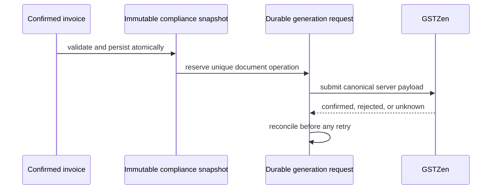

# GST statutory-document architecture

The repository now also supplies a SQL-side reservation procedure, immutable snapshot trigger, generation-attempt ledger, and a tested application state machine. The invoice-confirmation integration is deliberately not enabled: the sales model cannot currently supply a complete legal snapshot without policy decisions. A future implementation must create the snapshot during confirmation, hash canonical data, reserve one request per snapshot/document type, and never submit client JSON.

`GstComplianceSnapshotReadinessEvaluator` is the current pre-snapshot boundary. It reads only persisted invoice values and returns blocking codes; it does not read mutable master data to fill historical fields.

## 2026-10-26 source audit

This is a source audit, not a staging, SQL Server, GSTZen sandbox, or production certification. `backend/database/migrations/20261024_gst_compliance_snapshot_generation_foundation.sql` has not been applied by this review.

| Capability | Status | Evidence and consequence |
|---|---|---|
| GST registrations, GSTIN verification, sessions and API-log history | Implemented but unverified | `GstRegistrationService`, `GstVerificationService`, `GstSessionService` and `GstApiLogService` in `backend/src/Cosmos.Application/Services/GstServices.cs`; corresponding `dbo.CompanyGst*` tables/procedures are in `backend/database/003_gst_integration_module.sql`. Live provider configuration has not been tested. |
| HSN/SAC, rate history, category defaults and item overrides | Implemented but unverified | Protected endpoints are in `backend/src/Cosmos.API/Controllers/HsnGstController.cs`; schema and page/permission seeds are in `20261015_hsn_gst_phase1_foundation.sql`; routes/pages are present under `frontend/src/pages/gst/`. The GST overview now links to those permitted screens instead of falsely declaring them unavailable. |
| Sales GST calculation and draft HSN snapshot | Partially implemented | `GstCalculationEngine` and the 20261016/20261019 migrations provide rule/classification foundations, but the statutory invoice snapshot is not created during invoice confirmation and confirmed invoices do not persist the full legal/tax/transport contract. |
| Immutable compliance snapshot and idempotency foundation | Implemented but unverified | `dbo.GstComplianceSnapshots`, `dbo.GstGenerationRequests`, `dbo.GstGenerationAttempts`, `dbo.usp_GstGenerationRequest_Reserve`, and `dbo.usp_GstGenerationRequest_RecordAttempt` are additive in `20261024_gst_compliance_snapshot_generation_foundation.sql`. They are not wired to a business-approved confirmation transaction. |
| E-Invoice and E-Way Bill generation | Intentionally blocked | `EInvoiceService.GenerateAsync` and `EWayBillService.GenerateAsync` call `GstGenerationSafety.ThrowUnavailable`. This prevents browser-provided JSON from reaching `GstZenProviderService`. |
| Retrieval, cancellation and E-Way vehicle update | Implemented but unverified | `GstServices.cs` calls the provider and persists only selected cancellation results. There is no verified sandbox evidence, no request reconciliation workflow, and vehicle updates are not persisted. |
| E-Way extension, lists/history and artifacts | Partially implemented / missing | An extension adapter method exists but its path/mapping is unverified; there are no document list/history endpoints and no verified download/print artifact endpoint. |

### Root causes and safe implementation order

1. Obtain tax/compliance approval for seller-registration selection, place of supply, document eligibility/correction, component-tax/rounding and transport-data policies.
2. Persist the approved fields in the sales confirmation transaction and create one immutable, canonical snapshot with its rule versions and hash. Do not backfill or recalculate historical invoices from current master data.
3. Obtain the provider's account-specific, current API contract and sandbox access; validate every endpoint/header/payload before enabling a server-side, snapshot-only submission workflow.
4. Wire SQL reservation, attempt recording and provider reconciliation into that workflow, then add list/history and supported artifact retrieval APIs and UI.

The currently published GSTZen E-Way Bill retrieval documentation requires both a token and the selected GSTIN header. The current provider adapter only configures its configurable token header (`GstZenProviderService.ConfigureHeaders`), so its registration-to-provider-header mapping is not verified and must be corrected from the account contract before statutory operations are enabled.
