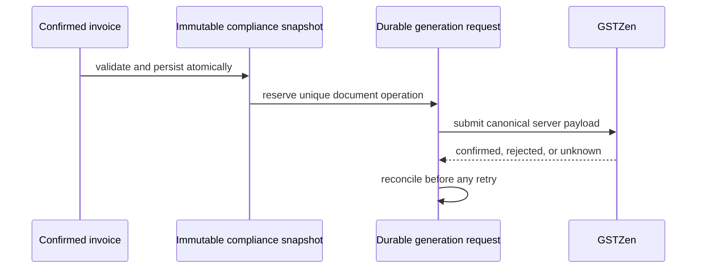

# GST statutory-document architecture

The repository now also supplies a SQL-side reservation procedure, immutable snapshot trigger, generation-attempt ledger, and a tested application state machine. The invoice-confirmation integration is deliberately not enabled: the sales model cannot currently supply a complete legal snapshot without policy decisions. A future implementation must create the snapshot during confirmation, hash canonical data, reserve one request per snapshot/document type, and never submit client JSON.

`GstComplianceSnapshotReadinessEvaluator` is the current pre-snapshot boundary. It reads only persisted invoice values and returns blocking codes; it does not read mutable master data to fill historical fields.
